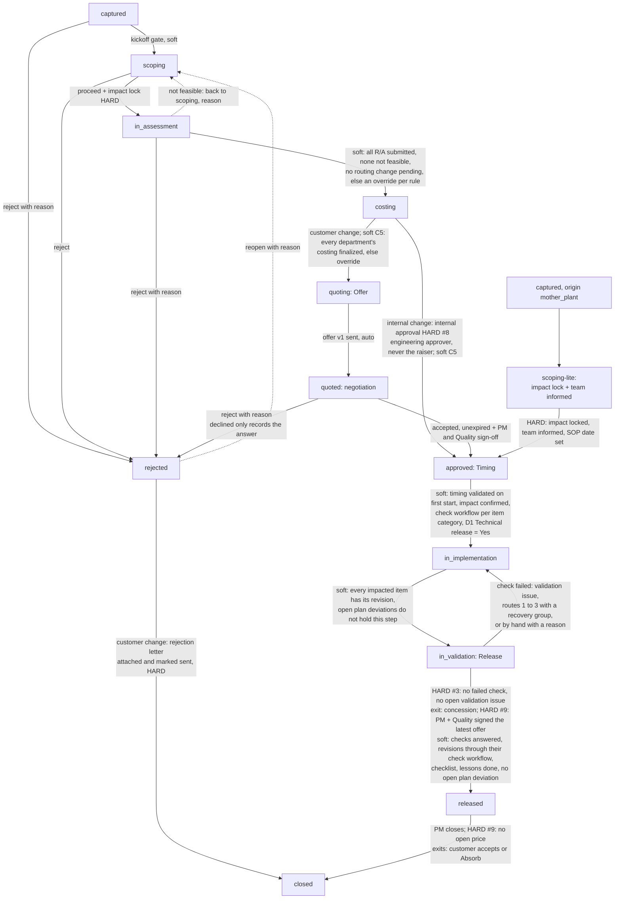

# Change Management — process flow (living document)

**Purpose.** One place holding what the change process actually *is*, so the
formal process flow + description can be written from it, and so an auditor can
be shown how each rule is enforced rather than asserted. Updated as decisions
land; every rule here names the code that enforces it.

**Status:** in progress. Sections marked ⚠ are open questions, not decisions.

Checked against the code on 2026-10-01 (ECR simulation desk check, TOC-PLM-06).

---

## 1. Where the flow came from

Two different origins, worth keeping straight:

| Part | Origin |
|---|---|
| Assessment routing, D1 approval matrix, per-department modules | `Documents/Changemanagement/ÄnderungsmitteilungChange_Management*.xlsx` — the real workbook |
| The `captured → scoping → in_assessment → …` state machine | Our design, `docs/superpowers/specs/2026-07-04-change-flow-path-to-quote-design.md` |

The original core design (2026-06-15) went `captured → in_assessment` directly.
`scoping` was introduced on 2026-07-04. **No customer-supplied process flow
defines these stages** — we are free to reshape them.

### The workbook's own structure (to reconcile against)

Tabs: `Änderungsinformation_D1` (master), then one per department —
`Vertrieb (Sales)_D2`, `Entwicklung (R&D)_D3`, `Wkzg. Entw. (tool design)_D4`,
`IE_D5`, `Qualität (QVP)_D6`, `Logistik_D7` (+`_D7_2`), `Produktion_D8`,
`Einkauf (purchasing)_D9`, `Fertigungsst. (production c)_D10` — plus
`Summierung`, `Std.-Sätze+Fzg`, `Änderungshistorie`, `Bauteilauswahl`.

⚠ **To review:** the workbook is the template the business already fills in.
Each D-tab should map 1:1 onto a department assessment module, `Summierung`
onto the cost summation, `Änderungshistorie` onto the audit trail, and
`Bauteilauswahl` onto the impacted-item picker. That mapping has not been
checked field-by-field. Do this before writing the formal description.

---

## 2. Stages

| Stage | What happens | Who |
|---|---|---|
| `captured` | Originator enters the request: project, description, documents, one-line reason, cost carrier, required-by date. **No meetings here**. Origin `customer`, `internal` or `mother_plant` (§3 "Mother-plant changes"; a `mother_plant` change is started by Project Management or an admin only, `MotherPlantService.may_start`) | Sales; **Project Management may act alternatively** (both departments carry `can_start_change`; the flag, not a hardcoded role, is what the API enforces) |
| `scoping` | Team decides: proceed / needs info / reject. Impacted set picked and locked (first action there: Development picks and confirms; the lead and PM may pick too), documents gathered. Description is frozen (Sales' capture text); discussion happens by email, thread attached. Mother-plant changes: scoping-lite, impact lock + team informed (read receipts), then straight to `approved` | PM convenes; decision recorded by any member |
| `in_assessment` | Routed departments answer feasibility + risks per the D1 matrix | Departments (RASIC) |
| `costing` | Cost lines with lead time, internal hours, estimates or vendor quotes; planned P&L starts. Closing forks on the cost carrier: customer → `quoting`, internal → internal approval → `approved` | Departments; PM runs it |
| `quoting` | Offer tab (Approval for internal changes): quote plan, price (cost basis, factors, risk weighting, changeover, piece price), document (CBD/rough, free fields, terms, PDF). Sending v1 auto-moves to `quoted` | Sales |
| `quoted` | Offer sent, valid 30 days from receipt; negotiation rounds against an offer version, new versions with "what changed". Acceptance of a sent, unexpired version freezes the planned P&L | Sales |
| `approved` | Timing tab: detailed plan seeded from the quote plan, bank build / scrap plan, every responsible team confirms or raises a concern, baseline set by "Timing validated", MS Project export. Publishing the plan to the customer is a side step, not a gate: it needs the bank build decision (running change or planned scrap) and is offered once timing is validated. Mother plant: release deadline = their SOP, "Inform" stamp instead of the publish | PM + Quality sign-off (customer changes) or internal cost approval; then PM + Scheduling + all teams for timing |
| `in_implementation` | Tracker: progress/actuals per block; date changes only via a deviation (reason required), locked or escalated. Recovery groups from validation issues land here. Actual P&L from here | departments; PM/Sales/lead/admin for deviations |
| `in_validation` | Release tab: validation checks plus the release checklist (16 items; 13 on a change that ended before the rework) and the lessons learned step; a failed check raises a validation issue (§3 "Validation issues") | departments, PM |
| `released` → `closed` | Change is live. The release needs, HARD (no override, not even an admin): no failed validation check (unless covered by an accepted concession) and no open validation issue; for a customer change the PM and Quality sign-offs on the latest offer sent. SOFT (override bound to the rule): every check answered, every impacted revision through its check workflow, release checklist complete, lessons step done, no open plan deviation. Close is HARD-blocked while a price is open (`price_open`). Summary with the P&L offer vs doing; then PM wraps it up | PM |

Off-path: `on_hold`, `rejected` (reversible), `cancelled` (terminal).

### Sanity checks per stage

Run these when discussing any stage's implementation:

1. **Can it be entered by accident?** Every entry should require the thing the
   stage is *for* to already exist.
2. **Does leaving it require a named person?** If not, the audit trail records a
   state change with nobody behind it.
3. **Is the negative path as well-served as the happy path?** Reject and
   needs-info deserve the same care as proceed.
4. **What does it cost to undo?** If irreversible, say so in the UI *before* the
   click, not after.
5. **Does the workbook have a tab for this?** If yes, the fields should line up.

---

## 3. Gates and rules, with enforcement

### Entering `scoping`
- **Soft:** the capture must be complete: a `description`, **at least one
  attachment**, (customer-relevant changes only) the **required-by date**
  (quote deadline), and a **change lead**. Missing pieces are listed in the
  message: *"Incomplete capture: missing description, at least one attachment,
  change lead before scoping"*. Overridable by an approved override.
  `change_service.py::kickoff_missing`, read by `_guard`.
  Rationale: Sales captures, the project team scopes — kickoff means handing
  over a request someone can actually work on. The impacted set is **no longer**
  required here: it is defined during scoping (Development, the lead and PM
  pick it) and stays hard-locked before assessment, as before. Since
  2026-10-14 the lock happens automatically at the meeting's `proceed`
  (see "Inside `scoping`").

### Capture (ECR-solid §2, 2026-10-15)
Switch `SCOPING_V2` (`app/services/capture_rules.py`, migration 124); the
soft kickoff guard above reads `kickoff_missing`, which adds:
- **Customer change**: a typed customer file (attachment kind
  `customer_file`, which the start form gives every dropped file of a
  customer change, or a filed `customer_email`) instead of "any attachment"
  (`customer file`), plus the quote deadline as before.
- **Internal change**: "what is wrong today" as a number with its unit
  (`problem_value` + `problem_unit`) and the `target_value` (`what is wrong
  today`, `target`); description and one evidence file or photo as before.
  Volume and saving come at the internal approval.
- **Urgent** (priority `critical`): the need-by date (`release_due_date`,
  settable at capture for an urgent change), a reason pick (`urgent_reason`:
  line_stop, safety, quality_escape, launch_date, customer_demand, other) and
  evidence (`urgent_evidence`, a reference: "ok", "tbd", "n/a n/a", a lone
  word without a number refused). Create and PATCH are refused without them,
  or with a need-by in the past (400); mother-plant changes keep their own
  SOP and are left out. The header reads "Urgent · Need-by 24 Oct, 8 wd
  left, now: Scoping"; with `START_AT_RISK` off (served `start_at_risk_on`)
  a customer change adds "No start before PO".
- **Create and hand over**: a complete capture is created and moved to
  scoping in one click; "Create as draft" keeps it captured.
- **Urgent proceed** (§3): `decide proceed` on an urgent change needs
  `need_by_check` (yes / at_risk / no + `need_by_proposed`, a date after
  today and after the need-by; *at_risk* only with `START_AT_RISK` on, off
  the dialog reads "No start before PO"). On a customer
  change (the cost carrier proceed goes on with) anything but yes notifies
  the Sales owner (else Sales) once and gives all of Sales the task
  `need_by_tell` ("Tell customer: new date or start at risk?", owner named),
  answered with a filed mail or a reference (`POST /changes/{id}/need-by/tell`).
  An internal change has no customer and no Sales owner: *start at risk* is
  not offered (refused), *no* is recorded and the lead (else the raiser) is
  told once; Sales gets nothing (L4 review).
- **Urgent rule on edits**: create, and a PATCH that moves the urgency itself
  (priority, reason, evidence) or the need-by during capture or scoping, run
  the urgent check; a later release-deadline move of a critical change (a
  legacy one without reason and evidence included) is a plain deadline edit.

### Inside `scoping`
- **Scope (defined by PM)** (2026-10-14): the project manager writes down what
  is in scope of the change, as free text (`change_requests.scope_definition`,
  migration 115). Editable while the change is `captured` or in `scoping` by
  Project Management members, the change lead and admins (acts-as aware),
  audited in the changelog on every change (`scope_defined`), read only
  afterwards. Shown prominently on the Scoping tab and read only on Overview,
  Assessment and Costing so the departments see what is in scope. Optional,
  not a gate. `PUT /changes/{id}/scope-definition`,
  `ChangeService.set_scope_definition`.
- **Impacted parts are picked here, and locked by `proceed`** (2026-10-14):
  Development, the change lead and PM pick the impacted parts in scoping.
  Development's separate "confirm the impacted parts" step is **switched off**
  (`app/services/cm_switches.py::IMPACT_CONFIRM_STEP_ENABLED = False`, served
  to the UI as `impact_confirm_step` on every change). Its code, task and
  button stay for a later reuse. While it is off: the meeting's `proceed`
  locks the impacted set automatically (who/when = the decider, changelog
  `impact_locked`); an empty set refuses `proceed` (*"No impacted parts
  picked: pick the impacted parts on the Impacted tab before proceeding"*);
  the confirm task leaves My Tasks; `POST /impact/confirm` is refused. An edit
  by the lead, PM or an admin after the lock keeps the set locked on the
  editor's name (nobody confirms by hand any more). A mother-plant change
  locks its set when it goes `scoping -> approved` (empty set refused); an
  engineering review keeps Development's lock, because there the lock is the
  act that opens the review.
- The onward move is **the meeting's call, not a button**. The cockpit offers no
  advance button at `scoping`; it points at the scoping tab.
  `changeStatus.ts::DECIDED_BY_MEETING`.
- **Concerns** — any team member may flag `reject_proposal` (cancel vote) or
  `needs_info` (question; with `SCOPING_V2` a question or a check item, see
  "Scoping is triage" below) with a note; naming a department is attribution only.
  Risks are **not** raisable here — the register belongs to assessment. Settling
  ("mark solved") belongs to the author or a Project Manager member — attribution
  hands the named department (Sales, typically) nothing, admins are *not* exempt,
  and the acts-as switch sets personal authorship aside. One open concern per
  person per kind. `meeting_service.py::raise_concern` / `withdraw_concern`; see
  `superpowers/specs/2026-08-12-scoping-concerns-and-settle-rights-design.md`.
- **Open concerns block `proceed`**: the decision must either be answered by
  the author withdrawing (or PM settling it), or by a negative decision that
  consumes it. Pressing `proceed` with open flags opens a warning dialog that
  lists each flag (kind, author and department, note) and says how it is
  cleared; the backend refusal lists them too (2026-10-14,
  `MeetingService.open_flags_refusal`).
- Meeting decision `reject` requires a reason; `needs_info` requires stating
  what is missing. `proceed` needs no justification.
- A negative decision **resolves** the open concerns and its reason becomes the
  change's `rejection_reason` — one decision, one justification.
- `needs_info` keeps the change in `scoping` and raises a tracked question for
  the **decider's department** (acting as a department: that one; else Project
  Management when the decider sits there; else their only department; else
  the decider personally). It follows the question rule below.
- After a negative decision, an **attachment slot** appears for Sales/PM to file
  what they send the customer — rejection letter, open questions, or a
  counter-proposal.

### Scoping is triage: questions and check items (C33, C13, 2026-10-15)
Switch `SCOPING_V2` (`app/services/cm_switches.py`, default ON, served to the
UI as `scoping_v2` on every change). Live test 1 showed the room
over-analysing: departments flagged points they should assess on their own.
Scoping decides only *which parts, who assesses, go/no-go*.

- **Quick add** (Scoping tab, one line, under 15 s): the point, **Raised for**
  (preselected: last used, else the viewer's own department on the change),
  **Check** (drawing / volume / cycle time / weight / tool / material /
  tolerance / schedule / other) and the part or *Whole change*. The default is
  a **check item** ("Unsure? Leave it.").
- **Make it a question** (toggle; the asker or a PM member can switch either
  way any time in scoping, `POST /concerns/{id}/type`): the UI asks *"Can we
  decide parts, assessors and go/no-go without this?"*. Only a *no* is a
  question, and it owes **who can answer** (customer / our team / supplier)
  and **what the answer changes in the scope** (refused without, spec R2).
- **Several questions per department**: the limit is one open question per
  asker, raised-for department and check-what (it replaces "one per person per
  kind" for questions); a second on the same pick is refused naming the open
  one. Beside the quick add the UI lists open items on the same pick with
  **Same as #n** (the raised-for department becomes co-owner, own department
  only) and **Add to #n** (the line is appended), `POST /concerns/{id}/join`.
  Check items have no limit. Cancel votes keep "one per person".
- **Questions hold `proceed` (HARD #2); check items never do.** Legacy flags
  (`flag_type` NULL, migration 121 backfills `question`) are questions, so
  in-flight changes behave as before. A new scoping raise names its type
  (`flag_type`; refused without, L4 review 2: a question owes who answers
  and what it changes, R2/R3).
- **Answer form** (`POST /concerns/{id}/answer` with `answer_kind`), nothing
  preselected: **Confirmed** = evidence: a customer question only by a filed
  customer mail (picked, `mail_id`) or the customer's document uploaded into
  the question; others also by a reference (5+ characters, not "ok"/"tbd").
  **Assumed** = value as a number with its unit (or "n/a"), the risk if wrong;
  confirmed by the Sales owner (else the lead) within 5 working days. An
  Assumed answer leaves a **confirm task** (`confirm_assumption`, My Tasks, due
  at `confirm_due`) for that person in any live status until someone who may
  answer it confirms it with evidence (`POST /concerns/{id}/confirm`). When
  the person named is the Sales owner, the row shows to all of Sales with the
  owner's name ([R3]); closed, cancelled or rejected changes take no confirm.
  Answering still does not close: the asker or PM closes [KEEP].
- **Proceed dialog**: open questions as a fix list (*Answer now* with the
  answer form, *Make it a check item*), check items collapsed by owner with
  *Promote to question*, and for a department that owns check items but is not
  routed *Route <dept>: C / R* (C first for Process and Quality; writes the
  meeting's RASIC). **Not routed holds proceed** (L4 review 2, R18): an open
  check item whose owner (or co-owner) the meeting does not route with a
  task letter (R/A/S/C; *I* owns nothing) would leave with no owner, due or
  task, so proceed waits until it is routed or the item reassigned
  (`MeetingService.unrouted_check_owners`, hold `unrouted_checks`, owner the
  lead; named in the refusal, the PM's row and the checklist). The button reads *"Proceed: 12 check items go to
  departments"*. **Go with conditions**: the meeting stores the open check
  items (`change_meetings.go_conditions`) and the changelog says how many.
- **Check items in assessment**: each belongs to its department (and co-owners)
  and is due with that department's assessment (`owner_due` on the concern
  list). The department cannot submit its assessment while one of its own
  check items is open (HARD #10, the existing department hold, now also for
  co-owners). See "Check items first and questions in the assessment"
  below for how it is closed (`ASSESSMENT_V2`; switch off: a member closes it
  with a resolution note).
- **C13, "Not yet"** (the meeting's `needs_info`, button *Not yet* in the UI):
  closes nobody's question. With questions open it needs no reason; it records
  *"Not yet: waiting for 2 answers (Process Engineer Thu, Tool Engineer Fri)"*
  (each side with the due weekday of its earliest question, the task rule)
  and raises nothing new. Without open questions it asks what is missing, which
  becomes the decider department's question as before. **Reject** still closes
  every flag [KEEP]. The PM's *Wrap up scoping* row reads *"Not yet: waiting
  for n answer(s) (...)"*, then *"Proceed waits for: PPAP decision (Quality,
  due Thu), notification or offer? (Sales), impacted parts (lead)"*, and
  *"Ready: proceed"* only when nothing holds proceed.
- **Proceed holds** (`MeetingService.proceed_holds`, L4 review): open
  questions and cancel votes (HARD #2), the PPAP decision and the flip's Sales
  answer (HARD #7), check items with no routed owner, no impacted parts
  (HARD #1), each with owner and due. The lead owns an empty impacted set:
  a My Tasks row *Pick the impacted parts* (`pick_impacted`, Impacted tab;
  Quality's PPAP *yes* waits on it and says so), and the cockpit counts every
  one of these holds. The
  PM's row and the change checklist (`next_step`, `who` = "Quality, due Thu")
  read it, the cockpit lists HARD #7 under *Blocked by* (never "Nothing
  blocking") and gives Quality *Answer the PPAP decision* as the scoping
  header action; a refused `proceed` names every hold at once (with the
  dialog's own fields: departments, R/A, cost carrier, the urgent need-by).
- **Internal: the raiser's department assesses** (spec §3, L4 review 2,
  `SCOPING_V2`): on a change raised as internal, the raiser's internal-starter
  department (Development / Process / Tool Engineer, first by sort order) is
  preset R in the room's RASIC (`recommended-departments` serves it with
  `raiser: true`). Leaving it out, or below R/A, needs a reason
  (`raiser_waive_reason`, 5+ characters, "ok" refused), logged as
  `raiser_department_waived`; checked when a meeting is recorded (unless an
  earlier one waived it) or an edit drops it, so in-flight meetings are not
  touched.
- **Confirm item rights** (L4 review): the list serves `can_confirm` per
  question (the named confirmer, or who may answer it; any live status, the
  question open or closed), and the card shows the confirm form on it, so
  the confirmer is never sent to a dead end. A named confirmer
  (`confirm_by_id`) must be an active writer of the change's organization
  (admin, or a member of an active department; not the stored role, which
  follows a new department only at the next login) and is told once
  (`confirm:<concern>`). A customer question is Confirmed only by
  a filed customer mail or a `customer_file` filed on the question (an
  internal `info_response` is no customer answer).
- **Same as / add to rights**: *same as* is a department act (members only;
  an admin acts as the department); *add to* is the asker's, the owning
  departments', Sales' or PM's and is refused once the question is answered.
  The list serves `can_add_to` (the same check, `MeetingService.may_add_to`):
  the quick add shows *Add to #n* only where it is true.
  *Make it a question* keeps the one-open-question-per-pick limit.
- **Customer copy**: a customer question carries its mail text
  (`customer_copy`: subject, what is asked, the part, what the answer
  decides); the question card and Sales' `obtain_info` row offer *Copy mail
  text*. A question PM closes over the asker tells the asker once.
- Switch OFF: every scoping flag is a question again and `needs_info` resolves
  the open flags (the 2026-10-14 behaviour).

### HARD #7: ppap_decision and the customer flip (2026-10-15)
Switch `SCOPING_V2` (`app/services/ppap_decision_service.py`, migration 122).
- **ppap_decision**: a change that goes on as internal owes Quality's
  answer before `proceed` (`applies`: one of ours, origin customer or
  internal, whose cost carrier is internal; while captured or scoped an
  undecided meeting's carrier wins, so a customer change the room sets to
  internal owes it before proceed instead of deadlocking at it). Quality is
  told once when it is needed (`ppap_decision:<id>`: entering scoping, or a
  meeting set to internal): *"Parameters / tool / material / cycle time changed
  on any part?"*, nothing preselected. **No** names its basis (control plan /
  process sheet / customer spec) and the document reference; **Yes** names the
  parts. One Quality member answers (an admin acts as Quality),
  `POST /changes/{id}/ppap-decision`; the card sits on the Scoping tab and the
  row in Quality's "Needs you" (`ppap_decision`, due 1 wd). `proceed` and the
  `scoping -> in_assessment` hop are refused until then (HARD #7, no override;
  `ChangeService.solid_hard_refusal`, `MeetingService.decide_meeting`).
- **Customer flip** (a *yes*, or a customer index on an internal change):
  `customer_relevant` + origin `customer`, the project's Sales contact as Sales
  owner, the project PM as lead (when the project names one), an undecided
  meeting's cost carrier follows to *customer*. The Sales owner and the lead
  are notified once (`customer_flip:<id>`; the lead's notice names Sales and
  asks nothing); all of Sales see *"Customer notification or offer needed?"*
  (`customer_flip`, 1 wd, owner named). **Notification only** needs a filed
  customer mail or a reference: the customer is told, the money stays ours,
  so the change goes back to **what it was before the flip** (Claude's
  decision, for Christoph's review): `customer_relevant`, origin and Sales
  owner as before (an internal change: false, internal, none), the lead
  before the flip (the raiser) while that person is active, the meetings the
  flip moved back to internal (`customer_flip` changelog row, `old_value`;
  the internal approval, HARD #8, before `costing -> approved`), the
  notification on the record (`flip_ref`). A flip from a customer index left
  the PPAP decision unanswered: it is owed again and Quality is told.
  **Offer needed** sets the quote deadline (`POST /changes/{id}/customer-flip/answer`,
  Sales members; a date from today on) and the change takes the customer
  path. `proceed` waits for this answer (part of HARD #7). **At approved or
  later** only *offer needed* sets `price_open` (HARD #9 at close: a
  supplement accepted, or Absorb); *notification only* opens nothing.
  *Notification only* is the **only** way back to internal: the lead's PATCH
  `customer_relevant=false` and a meeting's cost carrier *internal* are
  refused while a flip holds (`flip_holds`: flipped, not answered
  *notification only*; HARD #7, no override; the carrier editors say so).
  A flip while captured leaves the capture with its lead: the lead keeps
  *Hand over to scoping* as main owner (Sales and PM see it with the lead
  named).
  A PATCH internal -> customer by Sales or PM during capture
  or scoping is a cost-carrier correction, not a flip: no lead move, no Sales
  question (the quote tells the customer).

### The needs-info loop (2026-08-11)

A `needs_info` decision opens a tracked request/response cycle instead of a
note nobody owns:

1. The decision **auto-raises a Team flag** (`needs_info` concern, author =
   the decider) carrying the decision reason. Net effect per follow-up round:
   the prior flag is resolved by the decision, a fresh one is raised — the
   change always visibly owes exactly one answer
   (`meeting_service.py::decide_meeting`).
2. **The question stays the asking department's task** (2026-10-14, was
   Sales-only): my-tasks kind `obtain_info` goes to the members of the asking
   department (the concern's `department_id`; with none, its author) **and**
   to Sales **and** Project Management, shown with the asking department as
   owner. Any of them may answer
   (`MeetingService.can_answer_question`); acting as a department means
   exactly that department's rights, personal authorship steps aside. The
   UI says who it waits on (*"Waiting on APQP - open question: ..."*).
3. **Documents are classified**: attachments carry `kind`
   (`general | info_request | info_response`) and a response links to its
   request (`responds_to_id`, migration 046). The needs-info slot uploads as
   `info_request`; the UI pairs responses under their requests.
4. **Answer vs. closure are two acts** (2026-08-12): the asking department,
   Sales or PM *answer* the question (`answer_concern`, a comment; the flag
   stays open, and the `close_question` task goes to the asker and PM).
   **Closure** is the asker's or a PM member's call, unchanged: whoever asked
   the question judges the answer; Sales never marks solved. Question cards name the asker with their
   department role(s), not just the username. All steps audited.

### The two deadlines (2026-08-11)

One quote-by, one release-by; at any moment at most one is *active*
(`ChangeRequest.active_deadline`, `ChangeService.deadline_state`).

- **Quote deadline** (`required_by_*`) — customer-relevant changes only. Set by
  Sales at capture (part of the kickoff gate). Active until the change is
  quoted; `quoted_at` freezes a permanent quoted-on-time/late fact
  (`quoted_on_time`). Internal changes never have one.
- **Locked after capture, moved only by pushback.** From `scoping` on, changing
  the quote date requires a reason in the same PATCH; audited as
  `quote_deadline_pushback` (`change_service.py::update`, UI: cockpit "Push
  back"). The date has **one owner** (lead/Sales/PM); discovery has many
  mouths — a meeting outcome, or a department flagging timing in its
  assessment answer, feeds the owner, who records the pushback.
- **Release deadline** (`release_due_*`): born mandatorily at the moment of
  commitment: customer acceptance (Sales) or internal cost approval (the
  engineering approver, HARD #8); the
  API refuses the acceptance/approval without it. A mother-plant change takes
  it from their SOP at approval. Moving it afterwards needs a reason in the
  same PATCH (`release_due_reason`, required since 2026-10-01, UI: cockpit
  "Move"), audited as `release_deadline_set`; never clearable. Drives
  `deadline_state` from then on; escalations and the workload report follow
  whichever deadline is active.

### Inside `in_assessment` — the risk register (reworked 2026-08-11)

Risks at assessment are a **register, not a hold** — and assessment is the only
phase that hand-raises them (a scoping raise of kind `risk` is refused, and
assessment refuses the scoping kinds; 2026-08-12). A department records a
risk with a **standard type** — fill issue, dimensional issue, visual/surface,
process capability, other (free text) — a **severity rating 1–3** (3 =
highest) and a note, then submits its verdict regardless. No mitigation
proposal loop, no submit block: the pass decision is the
feasible / with-conditions / not-feasible verdict, and the register is what
travels.

- **Severity-3 risks surface to Sales on the commercial view** — they belong
  on the offer as technical judgment. Sales owns carrying them to the
  customer; the assessing department owns raising them.
- **"Reject" is not a raiseable option.** A department that cannot do it sets
  verdict `not_feasible` (which hard-requires the Change PPT, below).
- **"Needs info" is not a department concern anymore** — by assessment time
  it is too late, and everyone communicates with the customer directly.
  (Superseded 2026-10-15 by C8 with `ASSESSMENT_V2`: a department asks a
  structured question that holds only its own submit, see below.) The
  mail lands in the change-level customer-mail log (below). The
  scoping-*meeting* decision `needs_info` (a meeting outcome) stays.
- Legacy concerns (`reject_proposal` / `needs_info`) on old changes stay
  readable and closable with their old rules; only raising them is gone.

### Check items first and questions in the assessment (ECR-solid §4, C8, 2026-10-15)
Switch `ASSESSMENT_V2` (served as `assessment_v2`; migration 125).
- **Check items first.** The bucket opens with *"Checks for Process
  Engineer: 3 open"*: each item with its raise text, what to check, the part
  and the raiser. A member of an owning department closes it inline
  (`POST /concerns/{id}/check`), nothing preselected:
  **Answered** (a number with its unit, a reference of 5+ characters that
  names something, or a file filed on the item), **Not relevant** (the
  department's checklist row, a drawing reference, *outside our scope* + who
  owns it, or *same as #n*) or **Assumed** (value + unit or n/a, the risk if
  wrong; the confirm item goes to the Sales owner, else the lead, +5 wd, as
  for a scoping answer). Stored as `check_outcome` and the resolution note;
  logged `concern_withdrawn`, so the raiser's and the lead's daily digest
  count it as closed. A free resolution note no longer closes a check item
  in assessment: not for a member of an owning department (a raiser in that
  department included), not for Project Management or an admin. Project
  Management closes it through the same form (`settled_as` pm). Only a
  raiser outside the owning departments still drops their own item with a
  note. Nobody else "answers" it (`can_answer` is false on it). **Reopen** (`POST /concerns/{id}/reopen`, reason
  5+ characters): any closed check item, by the raiser or the lead, while an
  owning department still has its assessment open (after the submit there
  is nothing left to hold: ask a question or have the assessment sent back).
  The served `can_reopen` uses the same rule. The closer is told. A
  department routed C or S owes no submit, but while it owns open check
  items its assessment row is its task (*"Close your check items (n)"*, in
  My Tasks and the cockpit) until they are closed.
- **"Blocked? Ask a question" (C8).** A department raises `needs_info` with
  `flag_type` question from its own open assessment: one line, what it is
  about (check-what, part or whole change) and who can answer (customer /
  our team / supplier). Own department only, refused once it submitted, no
  check items here. It holds only that department's submit (HARD #10, the
  existing hold); scoping questions' rules for answering apply (asking
  department, Sales, PM; answer form only: a free note without Confirmed or
  Assumed is refused), plus the lead for a question for our
  team (routed to them: an internal change's engineering lead answers it),
  and the department closes it. Told
  once (`task_new`, subject `ask:<id>`): customer or supplier → the Sales
  owner, else every Sales member; our team → the lead, else Project
  Management; the obtain_info row follows the same split (Sales sees the
  customer and supplier questions only, each with mail text to copy, worded
  for the customer or the supplier). A department hold from before C8
  (no flag type) stays a proposal with its document in flight. The asker gets a badge when it is answered
  (`question_answered`). Per spec §0 the late clock is not paused: a wait
  on Sales counts as late.
- **Verdict evidence** (spec §4, `_validate_verdict_evidence`), nothing
  preselected: **impact yes** (any Yes row) = each Yes says in its remark
  what changes (part, tool, process sheet) and the evidence ("insert 3
  re-cut, DRW-4471 rev C"; a free line's label counts); **impact no** (every
  row No) = each No of the department's current checklist carries its
  reference (`ref`: checklist, drawing or report; the form offers one
  reference for every No without one). "ok", "checked" and the like are
  refused; a number with its unit counts. **Feasible with conditions** names
  the condition (5+ characters). In flight: an answer started on the
  earlier checklist resubmits as it is (judged by what the row already
  carries; a new draft is saved without keys only the earlier checklist
  asked, so a crafted draft buys no exemption); the questionnaire "not impacted"
  (Packaging) is unchanged.
- Switch off: assessment takes risks only, a member closes a check item with
  a resolution note, the checklist takes bare Yes / No.

### Assessment documents & customer communication (2026-08-11)

Three typed containers, three responsibilities:

| Artifact | Container | Responsible | Rule |
|---|---|---|---|
| **Change PPT** (internal explanation of the change) | per assessing department's bucket (`kind=change_ppt`) | assessing department | required for a `not_feasible` verdict (replaces the generic evidence gate) |
| **RFQ** (external: supplier pricing & timing) | per assessing department's bucket (`kind=rfq`) | assessing department | required at submit when "external modification" is Yes (since 2026-09-27; .pdf, .xlsx, .xls, .docx, .msg, .eml) |
| **Customer mails** (.msg/.eml/pdf) | change level (`kind=customer_email`) | everyone uploads, Sales owns the customer relationship | chronological tracked list, visible to all — the customer-communication record of the change |

### Assessment shape (2026-08-11, in build)

- **Process owners see their task, not the board (2026-08-11).** An ordinary
  member's assessment tab is their own department's bucket, auto-expanded,
  plus one slim progress line ("4/6 submitted — waiting on …"). The full
  per-department board belongs to PM, Sales, the change lead and admins.
  Who is still owed ("Assessment: waiting on Development, APQP (4/6)") is a
  ⏳ row in the cockpit's **Blocked by** card for every viewer (2026-09-24:
  the separate wait banner above the cockpit is gone; `resolveWaitStates`
  feeds `CockpitSummary`'s `waits` prop).
- **A bucket binds to the row that matters now**: the active one, else the
  latest answer, else the earliest dormant one — a submitted verdict never
  disappears behind a not-yet-started later stage, which shows as "Later
  stage" (queued), not as unclaimed work.
- **Buckets auto-populate with the department's domain objects**, derived
  from the impacted parts via the serves links: Tool Engineer → tools/molds,
  Manufacturing Engineer → equipment, APQP → gauges + documents,
  Development → the part design itself.
- **Physical-part changes route exactly five departments**: Development,
  Tool Engineer, Manufacturing Engineer, APQP, Packaging Engineer. Packaging's
  bucket opens with "packaging impacted?" — if yes: layout change / packaging
  type / modification; "not impacted" is a complete assessment. Sales, PM,
  Scheduling and Quality carry no assessment tasks for physical part changes.
- **No cost fields at assessment.** Cost (the workbook's per-department
  activity grids — hours × rates per plant, one-time vs lifecycle) belongs to
  `costing`.
- **The impact checklist (2026-08-11, replaces the workbook activity lists as
  assessment questions).** Config, not data
  (`GET /changes/reference/assessment-checklist`). **13 common items**: cycle
  time change, increased scrap, increased maintenance, 3D change necessary,
  dimensional risk, visual risk, work instruction update, new process, spare
  part required, internal modification, external modification, prototyping,
  matching/sampling. **Extras**: APQP → PFMEA update, control plan update;
  Development → article design update (internal vs customer-given). External
  modification = Yes **requires two documents at submit** (2026-09-27): the
  change presentation (`kind=change_ppt`; .ppt, .pptx, .pdf) and the change
  RFQ (`kind=rfq`; .pdf, .xlsx, .xls, .docx, .msg, .eml), both filed against
  the assessment. Declared per item in `REQUIRES_DOCUMENTS`
  (`assessment_checklist.py`), served as `requires_documents`; the submit is
  refused with "External modification needs the change presentation (PPT)
  and the change RFQ attached before you submit" (naming only what is
  missing), drafts save without them, and the row shows one upload slot per
  document. Upload refuses other file types for those two kinds. No other
  item declares a document. **`not_feasible` hard-requires the Change
  PPT** in the department's bucket (see the document table above).
  Checked items seed the department's costing grid (cycle time → lifecycle
  line, rest one-time; remark travels as the line note; deliberate deletions
  are remembered).
- **Every checklist row is answered (2026-09-24,
  spec `docs/superpowers/specs/2026-09-24-assessment-checklist-answers-design.md`).**
  Each `details.impacts` entry carries `answer: "yes" | "no"`; `impacted`
  is derived from it server-side (`answer == "yes"`), so costing, the RFQ
  hint and the cost-task skip read what they always read. No rows are
  stored. `_validate_impacts` refuses a submit whose checklist is
  incomplete and names the unanswered rows. Exempt: a
  questionnaire "not impacted" (`details.impacted is False`), a submit
  without `details.impacts` (API callers), and old submissions made only
  of legacy rows (activity id, or a bare line with no answer). The form
  holds the submit until the checklist has loaded and every row is
  answered. **Rest → No** fills only unanswered rows and marks them
  `bulk: true`; a row changed by hand drops the mark; the bucket shows
  "n × No (b set via Rest → No)".
- **Risks flagged from a row (2026-09-24).** `change_concerns.checklist_key`
  (migration 085; a checklist key or `free:<label>`, ≤120 chars, risks
  only, validated against the department's checklist) links a risk to the
  row it was raised from. The row lists its open risks compactly and jumps
  to the card; the card in the department's risk panel says "from: <row>"
  and is the only place for proposal / resolve / delete. The panel's own
  button is "+ Risk not on the checklist". Submitted answers name the Yes
  rows and mark those with open risks (⚑).
- **Delete a risk raised by mistake (2026-09-24).** `POST
  /changes/{id}/concerns/{cid}/retract`: its raiser only, open risks only,
  refused once a mitigation proposal (`answered_at`) or a document
  (`concern_id` attachment) exists. Sets `retracted_at/by` (migration 086);
  `is_open` is false, the concerns list omits it, the changelog records
  `concern_retracted`. Nothing is erased; the changelog is hash-chained.
  Resolving a risk ("Risk resolved") asks "How was it addressed?".

### Costing & timing shape (2026-08-11, in build; positions added 2026-08-12)

- **Per-department cost buckets at `costing`** (since 2026-10-14 already in
  `in_assessment`, per department from its own feasible submit: see
  "Per-department pipeline" below): same accordion philosophy as
  assessment: each participating department files one-time lines (activity
  from its catalog or free label, per plant, hours × rate snapshot + external
  cost) and lifecycle lines as **production-time deltas** (± min/part, per
  plant). Departments see only their own figures; **PM and Sales see all**
  (summation: per-department, one-time vs lifecycle, grand total).
- **Cost positions (2026-08-12)** — each department states, as tagged
  positions (standard tags like moldflow, external design, tool change, gauge
  change, testing … or free text): its **internal effort** (time spent on the
  assessment), its **estimated support during implementation**, and
  **external positions** priced either as an estimate or by **vendor quotes**
  — one table row per vendor: uploaded quote document, cost, lead time,
  shipping stated separately or declared included in the offer. The
  department **votes a favorite vendor**; Sales chooses later. **Sales has no
  input at costing** — they receive the full picture and build the quote from
  it. A department whose assessment marked nothing impacted (e.g. Packaging's
  "no change") owes no costing input and carries no costing task.
- **Timing**: each department's costing entry carries an implementation
  lead-time estimate; the change-level roll-up is the max.
- **Scoping like assessment**: at costing a department sees **only its own
  block**; PM and Sales see all blocks.
- **`quoting` — the create-quote stage (2026-08-12)**: costing closes the
  quote inputs, then the change moves `costing → quoting → quoted`. The
  quoting stage is **Sales-only**: they see all costs wrapped up per
  department (lines, lifecycle, positions with the favorite vendor) and build
  the quote from it. The implementation-timeline builder (MS-Project-like,
  Sales decides what runs in parallel) is a **future tool** — the stage
  carries a placeholder statement for now.
- **Quote**: Sales sets the quoted price manually with the summation (incl.
  the lifecycle time roll-up) as the internal basis — departments give time,
  Sales prices (the D2 "recalculation" job).
- **Activity catalogs remapped to our roles**: Production → Process Engineer,
  Logistics → Packaging Engineer (packaging) + Scheduling (stock/flow),
  Production control → Scheduling, Purchasing → deactivated (out of ECR
  scope for now).
- **Bank build is explicitly post-acceptance**: sizing needs a tooling
  downtime start date and confirmed lead times, which exist only once the
  customer accepts (release deadline born there). Costing may carry an
  estimate line; the plan itself belongs to implementation planning.

### Per-department pipeline: assessment and costing (2026-10-14)
Live ECR test finding: "assessment and costs should not have a blocker for
team members; team members should finalize both, to save time and not wait
for the whole team." Decision: a pipeline per department.
- **All assessment departments work at once.** The assessment is the first
  routing stage, and every department routed to it is open from the start
  of `in_assessment`; nobody's assessment waits on another department's.
  Checked 2026-10-14: no assessment template has a later stage that reviews
  an earlier stage's output (the only four-eyes step is the ECN check
  workflow's Design review, which belongs to implementation and is
  unchanged). The later stages of the shared "ECM Assessment" template
  (Summation & Budget, Customer activities) are Project Management's and
  Sales' process roles, not assessments; they stay dormant until `costing`
  (spec §16 P1-2) and never block a department.
- **Costing opens per department on its own submit.** A department that
  submitted `feasible` or `feasible_with_conditions` and whose checklist
  marked something impacted (`ChangeService.owes_costing_input`) opens, fills
  and **finalizes** its own costing while the change is still in
  `in_assessment` (`app/services/early_costing.py`, `costing_open_for`;
  `CostingPositionService.may_write`, cost lines, lead time, part weight and
  machine class follow it). Not feasible or nothing impacted: no costing
  owed, as before.
- **Finalize.** `POST /changes/{id}/costing/departments/{dept}/finalize`
  (members of the department, Project Management, admin) needs at least one
  cost line or position (a zero line is an answer, nothing is silence) and
  is recorded as `costing_finalized`. A finalized part is read-only for the
  department's members; PM and admin may still fix it. The department
  reopens its own input with `.../reopen` while costing is open (assessment
  or costing), recorded as `costing_input_reopened`. Stored on the
  department's assessment row (`details.costing_finalized_at/_by`, no
  migration).
- **Back to draft with the assessment.** When the assessments are superseded
  (back to scoping after a "not feasible") the rows go and every
  finalization with them; positions stay as the department's draft. Costing
  closed (`quoting`): neither finalize nor reopen; reopening costing for the
  change (reason, `costing_reopened`) keeps the finalizations, and a
  department that must change a number reopens its own part.
- **Who still owes.** `costing_pending_department_ids` = departments that
  owe a cost input and have not finalized, in `in_assessment` and `costing`
  (before 2026-10-14: in costing only, and any line counted). The change
  detail also carries `costing_owed_department_ids` and
  `costing_finalized_department_ids`.
- **The hop is unchanged.** `in_assessment -> costing` still waits on every
  R/A assessment, no not-feasible and no pending routing deviation. A
  department that finalized early stays finalized, so when every department
  has, costing is complete on entry and PM, Sales, the lead or admin may
  close it into `quoting` at once. Visibility (a department sees only its own
  figures; PM, Sales, the lead and admin see all), rate pricing by the ECR's
  creation date and Sales-only quoting are unchanged.
- **Surfaces.** My Tasks shows `costing_input` ("Enter costs") for the
  department right after its own submit, until it finalizes. The Costing tab
  opens with the assessment and lists only the departments already costing;
  the department's assessment bucket offers **Continue to costing**. The
  cockpit reads "Costing: 3/5 finalized, waiting on ..." (muted, as
  information, during assessment; a wait in costing).

### "<Dept> has no cost" and waiting on a supplier (ECR-solid §4/§5, C18, 2026-10-15)
Switch `ASSESSMENT_V2` (migration 126: `supplier_waits`).
- **"<Dept> has no cost"** (C18, `POST /costing/departments/{d}/no-cost`,
  members, PM, admin): one button beside Finalize instead of an invented
  zero, nothing preselected: *no work* / *absorbed* (the hours absorbed, an
  estimate; 0 refused) / *the supplier does it*. It finalizes the
  department's costing (stored with the finalization on its assessment row,
  `details.costing_no_cost`; served as `costing_no_cost`; logged
  `costing_no_cost`); reopen drops it. Refused while the department has a
  costing position, a cost line with hours or money, or an open supplier
  wait, naming the colleague ("Dale has an open supplier quote (Waiting on
  FZ until 3 Nov)"). Toolshop reads *"Will toolmakers spend time on this?"*.
  The checklist's timing risk stays a costing row (spec rev 6 replaced the
  audit's "exclude timing_risk" with this button).
- **Waiting on a supplier** (one state everywhere, `supplier_wait_service`,
  `GET/POST /supplier-waits`, `POST /supplier-waits/{id}/close`): vendor,
  asked on (today or earlier), expected by (not in the past), optionally the
  position it prices; phase *costing* (assessment, costing) or
  *implementation* (approved, in implementation). Recorded by the
  department, PM or admin, only for an active department that works on the
  change (routed for its assessment and costing; implementing it
  afterwards); one open wait per department and vendor. The header and the
  digest show the waits of the phase the change is in. While
  open: the department's finalize and "no cost" are refused; its
  `costing_input` row is due at expected-by (the late clock pauses, spec
  §0, also in the sweep and the lead's Overdue group via `owed_items`); C5
  lists it ("Waiting on FZ until 3 Nov (Toolshop)"); the header reads
  *"Waiting on FZ since 7 Oct (Toolshop, day 9 of 27)"*; the daily digest
  lists it as a wait. It ends *received* / *not needed* (the department) or
  **Price on estimate** (§5, the lead, PM or admin at close costing; the
  department is told, `task_new`, to finalize on its estimate); *Wait for
  FZ (3 Nov)* changes nothing.

### Costing positions name their basis (ECR-solid §4, C25, 2026-10-15)
Switch `ASSESSMENT_V2` (migration 127).
- **Basis per line** (`costing_positions.basis`, served as the effective
  basis): own time, machine time and sampling are *hours × the department
  rate* (shown); an external line is a *vendor quote* or an *estimate* (+
  its reference: an earlier tool, the supplier's figure and its date,
  `basis_ref`) or *same as* a part (`basis_part_id`) + what differs (size,
  cavities, material, slides; `basis_differs`). Positions of in-flight
  changes keep `basis` NULL and read it from kind and pricing.
- **Finalize** refuses (one sentence per kind, naming the lines): a quoted
  line whose counted offer has no supplier quote number (`quote_ref`, 3+
  characters) or no quote file (`vendor_quote` attachment on the offer), or
  that has several full offers and no favourite; an estimate with money and
  no basis that names something ("ok" refused); a pending quote-vs-estimate
  check. Offers carry `quote_ref`, `quoted_on`, `valid_until` (not before
  the quote date).
- **"estimated"**: an external line priced on an estimate is marked on the
  costing row and on the offer's cost basis lines (`estimated`), and the
  internal approval says "Tool cost ESTIMATE" (§5).
- **Quote vs your estimate** (spec [R4]): an offer with a quote number on a
  position that had an estimate, after an offer went to the customer
  (`quoted_at`) or the internal approval was given, marks the position
  `estimate_check = pending`; the department is told once
  (`estimate_check:<position>`, unless it entered the quote itself) and gets
  the task *"Quote vs your estimate"* (`estimate_check`, costing tab), and
  answers, nothing preselected, *within +5 %* or *above by x*
  (`POST /costing/positions/{id}/estimate-check`, members, PM, admin), in any
  status from then on: the costing window does not apply. A quote that
  reached the department directly is recorded in the same step (supplier,
  quote number of 5+ characters, amount: the offer is created on the
  position). The positions list serves `can_check_estimate` with the same
  rule. Above sets `price_open` (HARD #9 at close) and one
  task: customer change, the Sales owner (no Sales owner: all of Sales; Sales
  sees it) *"Estimate low by x: send a supplement or absorb"*; internal, the
  approver and the lead *"Cost x above the approved estimate: absorb with a
  reason"* (the approver decides the Absorb; there is no re-approval step)
  (task `estimate_low`, told once `estimate_low:<position>`). Absorb (or the
  customer's acceptance) clears `price_open` and marks those positions
  `settled`, so a later open price for another cause does not bring their
  task back. The automatic comparison is cut 2.

### Close costing: ready to quote, the internal approval card (ECR-solid §5, 2026-10-15)
Switch `ASSESSMENT_V2` (migration 128).
- **Ready to quote**: closing costing (`costing -> quoting`) on a customer
  change tells the Sales owner once (`task_new`, `ready_to_quote:<id>`;
  without a Sales owner every Sales member), unless they closed it
  themselves. The quote task is theirs from then on.
- **Internal approval card** (HARD #8 kept: an engineering approver, never
  the raiser): the cost (the summation) with a **"Tool cost ESTIMATE"**
  banner while any external line is priced on an estimate, and the case,
  nothing preselected: **why** (`internal_rationale`: saving / quality /
  capacity / safety / maintenance / other) always; with money also the
  **annual volume** (pcs/year), the **saving per year** (0 for a quality
  change) and whether it is **calculated or estimated**; the **payback**
  (months = cost / saving × 12) is computed in the card. All at no cost:
  one click + the rationale. `POST /internal-approval` refuses a missing
  part of the case in plain words; stored on the change and shown on the
  approved card. Switch off: release deadline only, as before.

### Impact edits after the lock (ECR-solid C16, 2026-10-15)
Switch `ASSESSMENT_V2`. Before C16 the run team changed the impacted set in
assessment, costing and quoting silently. Now (`EarlyStageService.
begin_impact_edit` / `_reopen_after_locked_edit`), in `in_assessment`,
`costing` and `quoting`:
- the edit needs a **reason** (5+ characters) like a post-quote edit; the
  Impacted tab asks it (*"Change the impacted set after the lock"*), served
  as `impact_edit_needs_reason` / `impact_edit_reopens`;
- the departments whose assessed objects moved (every routed R/A one when
  nothing is traceable) get their **finalized costing reopened**
  (`costing_input_reopened`, their costing task returns); in `quoting` the
  change first steps back to `costing` (no offer went out yet);
- each is told once (`impact_edited`, the assessment owner, else the
  department): *"Impacted items changed after your assessment: ART-B:
  <reason>. Check your answer; your costing is open again."*; logged
  `impact_edited_after_lock`.
Who may edit is unchanged (lead, PM members, admin; P1-5). Intake attach and
supersede (§1) pass their own reason. **Not built:** sending a submitted
assessment back on its own (spec "technical impact yes reopens
assessment"): the department checks its answer from the notice and its
reopened costing; a recall stays the lead's (open question for Christoph).
From `quoted` on: the scope change below, unchanged.

### Who owns the tool change (ECR-solid C21, 2026-10-15)
No switch (spec: C21 has none). The ECN check workflows (both templates,
`wf_seed_service.INDUSTRIALIZATION_STEPS` / `READY_TO_GO_STEPS`; migration
129 rewrites the live rows, new instances follow; running ones keep their
tasks):
| Step | R | A | S / C / I |
|---|---|---|---|
| Implement tool change | Tool Engineer | Project Manager | Toolshop S, Process Engineer C |
| Adjust process / parameter sheets (was "routing sheets") | Process Engineer | Project Manager | Manufacturing Engineer C |
| Clarify inspection plan / PPAP need | Quality | Project Manager | Sales C |
| Update master data & logistics | Scheduling | Project Manager | |
| Sampling / trial | Tool Engineer | Quality | Process Engineer S |
| Final release | Project Manager | Quality | Sales I |
The retired Production, Production control, Purchasing and Logistics own
nothing. **"Tool sampled"** is asked of the Tool Engineer only
(`validation_checklist.SAMPLED_BY`; older rows of Manufacturing / Process
Engineer stay readable, not owed). **Soft guard into validation**
(`tool_change_open`, "Tool change not done (Tool Engineer): T-3454"): every
impacted tool whose check workflow still has its *Implement tool change*
task open; override as for any soft rule into validation. **Toolshop**
(P7) has typical cost positions (toolmaker hours, in-house rework, EDM /
wire, steel / material, polishing / texture).

### Progress cadence asks only who works (ECR-solid C23, 2026-10-15)
Switch `ASSESSMENT_V2` (migration 130). `ImplementationService.
implementing_department_ids`: a department implements when it priced real
work (a position with money, hours, trials or a supplier offer; a cost line
with hours or money: a seeded zero line is no work) or its assessment said
*impact yes* (feasible with an impacted row, priced or not). Implementing
departments owe the progress report (twice a week), book hours and answer
their validation checks, as before. Per department the state serves
`cadence`: **reporting**, **waiting** (an open implementation-phase
supplier wait, "Waiting on FZ until 3 Nov", pauses it until the expected
date; the block offers *Waiting on a supplier*) or **done** (the latest
report says *Our part is done*, `implementation_reports.part_done`, which
cannot be at risk too; a later report without it restarts the cadence).
`owes_report` is false while waiting or done. Switch off: any line or
position counts, no pause.

### Entering `in_assessment`
- **Hard, unbypassable:** impacted set must be locked. Since 2026-10-14 the
  meeting's `proceed` locks it on the decider's name (switch off, see "Inside
  `scoping`"); with the switch on, Development confirms it by hand. Not even
  an approved override clears it.
- **Soft:** ≥1 impacted item (with the switch off, `proceed` refuses an empty
  set outright), lead assigned, deadline set, meeting with decision
  `proceed`.
- The **lead item pins here** — departments are routed against it. Editable in
  `captured`/`scoping` only.

### Who is on the hook: the room's RASIC call at scoping
Attendance at the scoping meeting makes nobody responsible, and absence takes
nothing away. The PM sets responsibility WITH the team, per department, on the
meeting record (`ChangeMeeting.department_rasic`, `{department_id: letter}`):
- **Letters:** R (Responsible, assesses), A (Accountable, assesses), S
  (Supports), C (Consulted/informed — no answer owed). "I" is accepted and
  stored as C. The picker starts from the change type's standard routing
  (every stage-1 department with its standard letter, served by
  `recommended-departments`); the room overrules it.
- **Routing follows the room:** on `proceed`, stage 1 is built from the map —
  the room's letter wins over the template's; a department the room added
  gets the letter it chose. Older meetings without letters keep the old rule
  (template letter, extras are R). Proceeding needs at least one R/A.
- **The department may still say no.** In assessment, a routed R/A department
  clicks "Not our responsibility" in its own bucket: reason required,
  optionally naming who should own it. That is the routing deviation
  `reletter → C` (plus `add` for the named department), decided by the change
  lead through the same 4-eyes panel. Rejecting restores the letter the routing
  gave; approving leaves the department consulted. Refused once the department
  has answered.
Every routing deviation now carries a reason (`apply_deviation`).

### The costing table (2026-09-16)
One table per department at `costing`, line by line. Rows 1–2 are standing
(assessment effort, implementation support, both own time); Tool Engineer has
a third (part weight, an estimate). Every further line is a **category from
the department's list**, and the category says what the line is:
- **own time** — hours (`kind=own_time`), valued at the department rate in the
  summation like the standing rows;
- **money, estimate** — a house number (`kind=external, pricing=estimate`);
- **money, vendor quote** — read from the favourite of the offers under the
  line (`pricing=quote`); one offer prices the line without a vote, several
  need the star. Sales' later choice is shown on the line, never edited here.
Categories: coded per department in `app/services/costing_tags.py` (each with
`entry_type` money|time, "other" in both types for everyone) plus the
department's own (`department_cost_categories`, migration 069, added from the
table's category dropdown with its type; soft delete). The free-text tag is
gone from the UI; the API still accepts any tag string.
The per-plant workbook grid (cycle-time delta, hours × rate) stays under the
table, collapsible. A department routed on several stages has one table.

**Full and partial quotes.** On a quoted line each offer is a **full quote**
(an alternative: one is bought, the star recommends which; several without a
star leave the line unpriced) or a **partial quote** (`is_partial`, migration
071: a part of the line, always counted). Line amount = sum of the parts +
the counted alternative; lead time = the slowest of those (calendar-day
compared). A part carries no star and cannot be Sales' choice; Sales decides
among the alternatives only.

**Vendors.** External lines are labelled "External · estimate" / "External ·
vendor quote". An estimated line may name who gave the number
(`CostingPosition.vendor_name`, migration 070); a quoted line names its
vendors on the offers. Every vendor field offers the **Suppliers master
data** and a new name typed there is stored as a supplier on save (best
effort), so the list grows the way the department categories do. Suppliers
are managed (renamed, deactivated) on the Suppliers page.

**Closing and reopening costing.** Departments enter lines while their
costing is open: in `costing`, or in `in_assessment` from their own
feasible submit on (per-department pipeline, 2026-10-14). Costing closes when it moves to `quoting`: **Project
Management, Sales, the change lead or admin** may close it (PM runs costing
and says when the numbers are complete). Sending the quote (`quoting →
quoted`) stays Sales/lead/admin. While in `quoting` the commercial tab says
costing is closed and offers **Reopen costing** to the same people who may
close it; the reason is mandatory and recorded as `costing_reopened`. PM and
admin may still fix any department's lines at any time (`may_write`).

### Quote plan and the Offer tab (2026-09-25, spec `2026-09-25-ecr-costing-to-close.md`)

`quoting` opens the Offer tab (labelled "Approval" for internal changes,
which still holds the existing internal cost approval). Sales works two
things there, in order:

- **Quote plan**: a rough Gantt seeded from costing
  (`ChangePlanService.seed`, template in `_template`), shared component
  `GanttPlanner.tsx` in `plan: 'quote'` mode. It exists so timing is visible
  before approval, not just after; the detailed plan at `approved` is a copy
  of it (`ChangePlanService.seed` with `plan: 'detailed'`).
- **The offer** (`change_offers`, `OfferService`, UI `OfferTab.tsx`): a
  draft is created per change (`OfferService.create`, 409 with the existing
  draft id if one is open), edited with `OfferService.patch` (deep-merge,
  a list key replaces the whole list), and sent with `OfferService.send`.

The offer's `data` covers three things the tab groups the same way
(`OfferPriceSection.tsx`, `OfferDocumentSection.tsx`, `OfferTimingSection.tsx`,
`OfferRisksSection.tsx`):
- **Price**: `cost_lines` seeded from the costing summation
  (`OfferService._costing_basis`, one line per department's internal money,
  one per external position at the chosen or favourite vendor); optional
  **factors** (percentage or amount, signed, e.g. overhead, margin,
  engineering fee, discount as sign -1); **risk weighting**, one row per open
  risk concern with its own percentage/amount and a `show` flag for the PDF;
  **changeover**, running change or customer-pays-scrap with a scrap
  quantity and unit price; **piece price** effect, optional, rows of
  delta-per-piece times annual volume. Totals are computed server side only
  (`offer_service.py::compute_totals`), the UI never recomputes them.
- **Document**: `cbd_mode` detailed or rough (a free description instead of
  the line-by-line table), plus free fields (label/value/amount) for
  anything not covered by the structured data, terms (payment, incoterms,
  delivery), a preview and the PDF.
- **Timing**: weeks from order and key milestones taken from the quote plan,
  a draft disclaimer, shown in the PDF's timing section.

**Versions and what changed.** Sending a draft (`OfferService.send`) makes
it `sent`, supersedes the previous sent version, sets `sent_at`/`received_at`
(default today) and `valid_until = received_at + 30 days`, writes
`change.quoted_price = total_one_time`, and moves `quoting -> quoted` through
`ChangeService.transition` (changelog `offer_sent`). A second and later
version needs a `change_note` (refused otherwise); `OfferService.serialize`
computes a `diff` against the previous non-draft version (cost line amounts
by key, factor/risk values, changeover, timing weeks, terms), which the UI
shows as "what changed" on the offer history.

**PDF** (`offer_pdf.py::render_offer_pdf`, A4, reportlab): letterhead, offer
number and validity, recipient, scope of change, the price section (CBD
table or rough description plus total), piece price effect, changeover,
timing with a plan bar chart, risks marked `show`, and terms including the
sentence "This offer is valid for 30 days from receipt". A draft renders
with a DRAFT watermark. No em-dashes anywhere in the generated text.

### Customer acceptance tied to the offer (2026-09-25)

Acceptance now checks the offer, not just the change. `apply_customer_response`
requires, when offers exist, that the **latest sent offer is not expired**
(`OfferService.is_expired`, `valid_until` in the past) unless the caller
supplies an `expired_override_reason`, which is recorded. Accepting sets
`change.accepted_offer_id` and moves the change on as before (release
deadline born here, unchanged); declining marks the offer `declined`.
Negotiation rounds now carry an `offer_id` (defaults to the latest sent
offer) so a round is tied to the version it was about
(`change_negotiations.offer_id`). Legacy changes with no offers at all keep
working exactly as before (acceptance with no sent offer is unchanged).

### Timing validation at `approved` (2026-09-25)

`approved` opens the Timing tab (`TimingTab.tsx`). The detailed plan is
seeded from the quote plan on first entry; from then until "Timing
validated" every plan editor's write bumps `change.plan_revision`
(`ChangePlanService._bump`), so a department's confirmation goes stale the
moment the plan changes under it.

- **Team confirmation**: every required department (every department with
  an R/A assessment row, plus Scheduling and Sales when they exist,
  `ChangePlanService.required_department_ids`) posts `confirmed` or
  `concern` (with a note) against the current revision
  (`ChangePlanService.post_feedback`, panel `TeamFeedbackPanel.tsx`). Only
  the latest row per department counts; a row whose `plan_revision` is
  behind the current one shows as stale and does not count as confirmed.
- **Baseline**: `ChangePlanService.validate_timing` stamps
  `baseline_start`/`baseline_finish` on every detailed task,
  `change.timing_validated_at/by`, changelog `timing_validated`. Refused
  when the status is not `approved`/`in_implementation`, there are no
  detailed tasks, validation still reports errors, any required department
  has not confirmed at the current revision, or an idea block (a Sales
  proposal, e.g. parallel bank build) is still in the detailed plan. It may
  be re-run while `approved`/`in_implementation`, which resets the
  baseline.
- **Publish**: Sales (or lead/admin) publishes the validated plan to the
  customer (`ChangeService.publish_bank_build_plan`, reused from the
  existing bank-build feature, button "Publish plan to customer" in
  `TimingTab.tsx`). The bank-build mode decision (running change vs
  planned scrap, `ChangeService.set_bank_build`) sits alongside timing on
  the same tab (`BankBuildCard`), predates this spec, and is unchanged by
  it.
- **MS Project export**: `GET /plan/export.xml` (`ChangePlanService.mspdi_xml`)
  produces MSPDI XML that MS Project opens directly, with a baseline block
  once timing is validated; `GET /plan/export.csv`
  (`ChangePlanService.csv_export`) gives a plain CSV.

`approved -> in_implementation` carries a **soft guard**
(`ChangeService._guard`, `to_status == "in_implementation"`): "Timing not
validated, every responsible team must confirm the detailed plan" when
`change.timing_validated_at is None`. It applies only on the hop out of
`approved` itself, not when resuming from `on_hold` or looping back from
`in_validation`, both of which re-enter a plan that was already live.

### Deviations after baseline (2026-09-25)

Once timing is validated, the detailed plan stops being freely editable:
`can_edit` is false, `can_edit_dates` stays true. Structural fields (name,
kind, lane, department, predecessors, is_idea, sort order) are refused;
`notes` stays editable; add/delete/auto-schedule are refused. A date or
duration change on a baselined task needs a `reason` (400 without one) and a
plan editor (`ChangePlanService._apply_dates`); it writes one
`change_plan_deviations` row per changed task with the old/new dates,
`slip_days` against that task's baseline end, and `finish_impact_days`
against the plan finish before the edit (the same value on every deviation
of one call), plus changelog `plan_deviation`. A date move no longer pushes
successors automatically after baseline; moving a chain goes through the
bulk `PATCH /plan/tasks` with one reason for the whole selection.

Open deviations show in the cockpit's "Blocked by" list. They do not hold
the work or `in_implementation -> in_validation`, but they **block the
release** (soft, `ReleaseService.guard_reason`) until each move is locked or
escalated. PM/Sales/lead/admin resolve each one (`DeviationsPanel.tsx`):
- **Lock** (`ChangePlanService.lock_deviation`): accepted internally, no
  customer impact recorded.
- **Escalate** (`ChangePlanService.escalate_deviation`): Sales is telling
  the customer; creates the existing stage-8 `ImplementationEscalation`
  (direction `customer`) and marks the deviation escalated.

### The tracker (`in_implementation`, 2026-09-25)

The Timing tab stays active through `in_implementation` for progress work.
`progress_pct`, `actual_start`, `actual_finish` are writable on the detailed
plan only, status `in_implementation` only
(`ChangePlanService._may_progress`): a plan editor writes any task, any
other member of the task's own department writes only that task. A `PATCH`
that mixes progress fields with anything else needs a plan editor, not just
the department. Twice-weekly progress reports and time booking predate this
spec and are unchanged; the deviation record (above) is what carries the
at-risk signal, there is no separate flag.

### Release checklist and lessons learned (`in_validation`, 2026-09-25)

`in_validation` opens the Release tab (`ReleaseTab.tsx`), alongside the
existing per-department validation checks.

- **Release checklist**: 16 fixed items, keyed and department-owned, config
  in code (`app/services/release_checklist.py::CHECK_KEYS/label_for/owner_for`).
  Reworked 2026-09-26 (corrected the same day: "APQP confirms SPC, cycle
  time comes from the tool engineer"): APQP owes `process_stable_apqp`
  ("Process stable: SPC Cm > 1.67", one row, APQP alone), `surface_quality`,
  `technical_quality`, `parts_measured` ("Measurements confirmed"),
  `customer_approval` (PPAP documentation and customer approval, asked
  once) and `control_plan`. The Tool Engineer owes `cycle_time_tool`
  ("changed" with the new seconds, or "unchanged"; merged from
  Manufacturing Engineer's `cycle_time_confirmed`; hinted with the Tool
  Engineer's validation measurement), `equipment_updated` and
  `weight_measured` (hinted when a validated weight exists). The Process
  Engineer keeps the process details in the process database (PDB) and
  owes no release row; Quality owns none either. Others: `index_updated`,
  `drawing_released`, `spare_parts` (Development), `packaging_updated`
  (Packaging Engineer), `erp_updated`/`stock_handled` (Scheduling),
  `customer_informed` (Sales). The five new rows (`ADDED_LATER`) are left
  off a change that ended before `PLM_RELEASE_ROWS_SINCE`
  (`release_checklist.keys_for`; "ended" is `ended_at`: `released_at`,
  else `cancelled_at` / `rejected_at` / `closed_at`, a finished change
  without a stamp counts as before); such a change keeps the old wording
  of the relabelled `parts_measured` and `customer_approval`
  (`OLD_LABELS`). Retired rows (`RETIRED_CHECKS`: `cycle_time_confirmed`,
  `documents_updated`, `process_parameters`, `process_fmea`,
  `quality_samples`, `quality_control_plan`, and the Process Engineer's
  `cycle_time` and `process_stable_pe` of the first 2026-09-26 version,
  `FIRST_VERSION`) stay on an old change as they were where they were live
  (a change that finished with the first version's `cycle_time` answered
  keeps it counted and never gains `cycle_time_tool`, `SUCCESSOR_OF`: a
  finished change never gains a row it was not released with), and
  anywhere else an answer given to them shows read-only ("No longer
  asked", `retired: true`) and is not counted (`retired_keys_for`). The cycle time
  and the optional Cm have no column: they are rounded (seconds to 1
  decimal, Cm to 2; the rounded Cm must exceed 1.67), and the rounded
  value is written into the note and the changelog
  (`release_checklist.answer_note`, `rounded_value`). The screen reads
  numbers en-US and refuses an ambiguous or unreadable one with a message
  instead of saving without it. Rows are written on first answer and
  answered with `done`, `na` (note required) or reset to `open`
  (`ReleaseService.set_check`, `ReleaseChecklist.tsx`) by a member of the
  owner department, PM, lead or admin (`ReleaseService.may_answer`).
  Future, not built: process engineering tasks will later be forwarded
  from the PDB to PLM.
- **Validation cycle time**: "Measured cycle time" (`cycle_time`, seconds)
  is measured by the Tool Engineer only
  (`validation_checklist.DEPARTMENT_CHECKS`, `CYCLE_TIME_DEPARTMENT`);
  Tool Engineer, Manufacturing Engineer and Process Engineer still answer
  "Tool sampled" and "Part measured". A cycle time Manufacturing or
  Process Engineer recorded before stays readable, marked "No longer
  asked" (`retired: true`), is never owed and never blocks the release;
  it cannot be answered again, a new issue is not linked to it, and an
  issue already linked to it closes with a note
  (`ValidationIssueService.check_retired`).
- **Lessons learned**: anyone on the change may add a lesson
  (`ReleaseService.add_lesson`, creates a `LessonLearned` linked to the
  change and its project). PM/lead/admin completes the step
  (`ReleaseService.complete_lessons`, needs at least one lesson or a
  `none_reason`), component `LessonsStep.tsx`.

`in_validation -> released` carries a **soft guard**
(`ChangeService._guard`, after the existing validation blocker and
ready-to-go check): `ReleaseService.guard_reason` returns "Release checklist
incomplete: n open" while any check is still `open`, else "Lessons learned
step not done" while `lessons_done_at` is null, else "n move(s) with plan
deviations still open: lock or escalate them first" while a plan deviation
is open.

### The new soft guards, together

Both new guards sit in `ChangeService._guard_reasons`, so an approved
override bound to their rule can lift them (`DeviationRequired`), unlike the
hard gates checked outside it (impact lock, approval, rejection letter, and
since ECR-solid L2 a failed check, an open validation issue, the sign-offs at
release and an open price at close; see §5 "Gates"):
- `approved -> in_implementation`: timing must be validated (this section).
- `in_validation -> released`: release checklist complete, lessons step
  done and no open plan deviation (previous section), checked after the
  pre-existing validation blocker and ready-to-go check so the most concrete
  refusal wins.

### Validation issues: the failure branch (2026-09-25, spec §12)

A failed validation check becomes an issue `VI-n` (`change_validation_issues`,
migration `090`), not just a bounce back. Shape, in order:
- **Raise**: routed department member, PM, lead or admin, in `in_validation`
  (or `in_implementation` after a loop back); a failed check offers "Raise
  issue" prefilled, one open issue per failed check.
- **Containment** (owner department, PM, lead): required before a route when
  severity is 3.
- **Root cause**: required before any route, except a concession the
  customer accepts as-is.
- **Route**, by PM or lead with a reason, 4-eyes (the decider is not the
  raiser unless admin): 1 `internal_rework`, 2 `supplier_rework`, 3
  `design_change` loop the change back to `in_implementation` with fix
  actions and a recovery group in the plan; 4 `customer_concession` closes as
  `accepted` only when, **with the customer mail filed** by Sales (hard
  rule), a Quality member records `accept_deviation` (with `RELEASE_V2`;
  switch off: Sales records it), `require_fix` (Sales) reopens the route; 5
  `follow_up_change` spawns a new change at `captured` and marks the issue
  `transferred` (an allowed exit: the defect stays visible in the follow-up,
  decided by PM or the lead with 4-eyes).
- **Re-validation**: all fix actions done → `revalidation`; the linked check
  answered `passed` closes the issue, a new `failed` reopens `fixing`. With
  `RELEASE_V2` a FAILED check is answered again only by a retest in
  validation, by its own department (acts-as aware; no PM or admin
  shortcut), with "what changed since" (parameter, tool, material or method
  + a reference, `cm_rules.reference_refusal`).
- **Raised in error**: an issue still `open` or `contained` (no route) is
  closed with a note; with `RELEASE_V2` only by a Quality member, the note
  naming the evidence (a reference of at least 5 characters).
- **Guard**: `in_validation -> released` is HARD with `RELEASE_V2` while any
  issue is open (no override; exits: fix and re-validate, a concession,
  raised in error by Quality, or a follow-up change); switch off: "n
  validation issues open" is a soft rule as before.
Code: `validation_issue_service.py`, `api/v1/changes/validation_issues.py`,
`components/changes/validation/`. Changelog `validation_issue_*`.

### Recovery timing and the escalation ladder (spec §12a)

A fix route (1 to 3) adds a **recovery group** to the detailed plan: summary
"Recovery VI-n", one block per fix action, "Re-validation VI-n", linked FS
into the blocks that waited on the failed validation (SOP, customer
approval), so scheduling pushes them. After the baseline every move is a
deviation with reason "VI-n: <route reason>". When the recovery ends after
the release deadline, Sales records the customer's `new_timing` (release
deadline moved, audited as `release_deadline_set`) or `require_fix` (PM
shortens the recovery); the recovery deviations are escalated together.

Every issue has an **escalation level** with history
(`change_validation_issue_escalations`):
- **L1 department**: on raise; owner department + PM informed.
- **L2 project**: automatic on severity 3, an overdue fix action, a recovery
  past the baseline finish, or no route after 2 working days; PM + change
  lead + Sales, Sales decides whether the customer is told.
- **L3 management + customer**: automatic when the recovery ends after the
  release deadline, an L2 is not acknowledged in 2 working days, or the
  customer requires a fix on a concession; Sales informs the customer (mail
  filed into the issue), management is notified; for a mother-plant change
  the PM informs the mother-plant contact instead.
Each level change writes a row, changelog `validation_issue_escalated`, a
notification and an "Acknowledge escalation" action; manual escalation needs
a reason; de-escalation only by closing or by the PM with a reason.

### P&L: offer vs doing (spec §13)

Every change compares the offer with what happened
(`GET /api/v1/pnl/changes/{id}/offer-vs-actual`, cost roles only). Planned
figures (revenue, internal, external, scrap) are **frozen at customer
acceptance** or internal approval in the accepted offer's `_snapshot.pnl`
(older changes fall back to current costing, basis `costing`). Actuals come
from booked hours x department rate, `change_actual_costs` entries
(migration `091`) and validation-issue costs by bearer (internal = our cost,
supplier = recoverable, customer = revenue once quoted). The result carries
planned and actual margin, variance and the timing slip. Touchpoints: planned
at costing and acceptance; actual at implementation, validation and release
(the release summary uses the same card). Code: `pnl_service.py`,
`api/v1/changes/actual_costs.py`, `components/changes/pnl/`.

### Mother-plant changes (spec §14, built)

Changes engineered and commercially handled by the mother plant:
`change_requests.origin = mother_plant`, `mother_plant_name` (dropdown,
default **KTX Weissenburg (WUG)**, second **KTX Solingen**, list in
`app/services/mother_plants.py`), `mother_plant_ref`, `mother_plant_sop`.
- **Flow**: `captured -> scoping -> approved -> in_implementation ->
  in_validation -> released -> closed`. No assessment, costing, offer or
  quote deadline (`customer_relevant` stays false).
- **Scoping-lite**: the impacted parts picked (since 2026-10-14 no manual
  Development lock: the move to `approved` locks the picked set, on the
  mover's name, and refuses an empty one), then "Send
  information" to the chosen departments: one `change_info_receipts` row
  each and a "Read and understood" task; open receipts show in Blocked by as
  information, not a gate.
- **Gate**: `scoping -> approved` only for origin `mother_plant`, hard-gated
  on picked impacted parts (the impact lock while the confirm switch is
  on), the team informed (information sent) and the SOP date
  set (`MotherPlantService.approval_blocker`).
- **Approved**: `release_due_date = mother_plant_sop` (reason "Mother plant
  timing"); detailed plan from their MS Project file, else empty with the SOP
  milestone. Timing as usual, with an "Inform mother plant" stamp instead of
  the customer publish; escalation L3 informs the mother-plant contact via
  the PM. P&L: actual local costs only (basis `none`).

### Revision intake and the engineering review (spec §17, built)

Every new customer index is captured and triaged: `revision_intakes`
(migration 096). A new major arriving through a gated path (customer package
with a `batch_id`, customer data, the upload dialog's "next customer data",
promote) is **pending**: status `in_review`, `parts.active_revision_id` not
moved, the BOM tree and the viewer fall back past it. Import scripts
(WinCarat, Brose, the 1994 resets) call `receive_customer_data` without an
`intake_source` and bypass the gate.
- **Triage** (Development, acts-as aware, admin), alone, route + reason
  (required for `administrative` and for any route other than the suggested
  one). Suggested: first data on an RFQ part `administrative`; official data
  or a series part `full_ecr`; else `engineering_review`.
  - `full_ecr`: a new customer change in `captured`, lead item = the part,
    the pending index as the item's `resulting_revision_id` (the ECN spawn
    skips it).
  - `attach_ecr`: the same link on an open change of the project; refused
    from `in_validation` on.
  - `engineering_review`: origin `engineering_review`, starts at `scoping`,
    lead = the decider. Development locks the impact; the lock asks
    Development, Packaging Engineer (articles) and the owners of the served
    objects (`ChangeService.served_objects`: tools, stations/EOAT, gauges).
    Each answers "no impact" / "impact" (note required). All "no impact":
    the index is activated, the change `released` and `closed`. Any impact,
    or none with a note saying why: Development escalates (audited) to a full
    customer ECR in scoping; the answers stay on its Review tab. No other
    status hop is allowed.
  - `administrative`: activated now.
- **Activation** is one helper (`RevisionIntakeService.activate`), shared
  with `ChangeService.release`: pointer, `approved`, `supersedes`, and a
  promotion's "approved / siblings rejected" happen only now.
- **Superseding**: a newer index for a part with a pending one archives the
  old one (intake `superseded`), unless the pending one is linked to a live
  change: then the receive is refused (409) with the change named.
- Release checklist hints "index updated" and "drawing and 3D data
  released" from the linked revisions. My Tasks: triage (Development) and
  open review answers (`GET /v1/intakes/my`).

### Intake triage and its follow-ups (ECR-solid §1, C9, C11, 2026-10-15)
Switch `SCOPING_V2` (`revision_intake_service.py`,
`index_followup_service.py`, migration 123). Off: the paragraph above.
- **What changed** (every route but administrative): the areas (geometry,
  tolerance, material, colour/grain, other / not sure) and a file or compare
  reference (>= 5 characters with a number or two words; "ok", "tbd",
  "n/a n/a" refused), or **no visible change**
  with a reason. On an impacted item it drives the follow-up below.
- **Administrative while a live change carries the part** (R19): the reason
  must name it (>= 5 characters, a number or a few words; "ok", "n/a n/a",
  "asdfg" refused, `cm_rules.reference_refusal`), and the leads of the live
  changes carrying the part are told once ("activated administratively
  (<reason>)"), as for every other route.
- **Live change holds the part**: the newest live change (not released,
  closed, cancelled, rejected) carrying the part is the suggestion
  (`attach_ecr`, preselected; the dialog names it with status and lead).
  `full_ecr` anyway needs a reason pick (separate topic / customer runs a
  separate EC / live change too far along / other + text) and links the two
  changes both ways (`change_requests.related_change_id`). **Every other**
  live change carrying the part is named too (`other_live_changes`, "Also
  carried by: CR-3 (Quoted, lead), CR-5 (Costing)"), and at triage their
  leads are told once (`index_other:<intake>:<change>`) to check whether
  their assessment, costing or offer still holds (L4 review).
- **A newer index is never refused** (minimal C11): it waits for its own
  triage (the customer package preview says where it will land). Attached
  to the change that carries the part, it supersedes there: a pending
  customer index of that change (its intake `superseded`, revision archived)
  or the internal minor the change spawned (its check workflow cancelled,
  archived); `intake_replaced` on the change and the part. Refused from
  `in_validation` on, as attach is. Attach and supersede are triage actions,
  not run-team impact edits.
- **full_ecr hands over (C9)**: the index's files are linked on the change
  as `customer_file` attachments (by reference: deleting one from the change
  never removes the revision's file), the Sales owner is the project's Sales
  contact, the lead the project PM; the change is **handed over to
  scoping** at once (the soft kickoff rule is logged, `handover_logged`, not
  overridden), so the lead schedules scoping while Sales sets the quote
  deadline (task `set_quote_deadline` in scoping, all of Sales, owner named;
  owed before assessment, `no_quote_deadline`). Both are told once
  (`intake_handover:<id>`).
- **Follow-ups on an impacted item** (the part was on the change: the new
  index D replaces C there):
  - **Recheck** (`change_rechecks`, task `assessment_recheck`, 2 wd) for
    every routed department that had submitted; per picked area "no effect"
    (drawing ref or checklist row) or "effect" (what + evidence), plus
    "something else changed"; nothing preselected; only that department
    answers (`POST /changes/{id}/rechecks/{rid}/answer`). An effect before
    the offer is sent reopens the department's finalized costing (in quoting
    the change first steps back to costing, the correction path, logged; it
    is a system consequence of the department's answer, not a run-team hop,
    and the Sales owner (else Sales) and the lead are told once: "Offer on
    hold: <dept> recosts for index D", `recheck_back:<id>`);
    from quoted on it is a scope change of type customer index
    (`scope_changed_after_quote` + `costing_update` for that department).
    No visible change: no rechecks. A department that had not submitted sees
    "Index changed to D: assess on D".
  - **Lead** (task `index_decision`, 1 wd, past scoping; the notice names
    the due weekday): "Index D adds parts or departments?" no / yes + which
    (`POST /changes/{id}/index-followups/{intake}/scope`, run team; PM rows
    name the lead as main). An index attached during capture or scoping
    makes it owed from the entry into assessment: the row starts then (never
    overdue at birth), names the new index ("C -> D") and the lead is told
    once at proceed.
  - **Sales** (an open quote, task `index_deadline`): "D replaces C; deadline
    holds?" holds (filed mail or ref) / new date (date, today or later, +
    the customer's filed mail; a typed ref is refused, R17) / not
    asked yet (Assumed, confirm by +5 wd: `index_deadline_confirm` until
    holds or new date) (`.../deadline`, Sales members).
  - **Internal change**: triage asks "Customer-driven?" (yes for a customer
    drawing); yes is the customer flip (HARD #7 section).
  - Open rechecks and the lead's question join the C5 line ("Costing not
    finalized: ... · Recheck on the new index: Process · New-index task").
- Read: `GET /changes/{id}/index-followups` (the Assessments tab card).

### The tab structure (2026-09-25)

Tabs, in order: Overview, Scoping, Impacted, Assessments, Costing, Offer
(Approval for internal changes), Timing, Release, then the governance group
D1, Audit. `costing`, `offer`, `timing`, `release` each unlock at their own
status (`offer` unlocks already at `costing`, so the quote plan can be
prepared while costing still runs); the active tab follows the change's
current status (`quoting`/`quoted -> offer`, `approved`/`in_implementation
-> timing`, `in_validation`/`released -> release`). Old links still work: a
`target_tab` of `commercial` resolves to `costing` or `offer` by status,
`implementation` resolves to `timing` or `release` by status
(`changeStatus.ts::resolveChangeTab`).

### Risk vocabulary: coded baseline + the department's own additions
- Coded per department in `app/services/risk_types.py` (own types, then the
  common timing/cost/other). Legacy moulding keys stay valid for everyone.
- A department **adds its own types** from the risk form ("+ Add own risk
  type…", `department_risk_types`, keys namespaced `d<dept>_<slug>`); members,
  PM and admin may add or remove. Removal is soft: off the dropdown, rows raised
  under it keep their key and stay valid; adding the same name revives it.
- **Risk templates** (`department_risk_templates`): pre-written type + severity
  + wording, picked in the form to prefill, saved from it with a tick, soft
  deleted. Same writers.

### Adding a department during `in_assessment`
Somebody was forgotten, or something turns out to be impacted after all. This
is NOT a recall to scoping (that tears down everyone's work and is refused once
anything is submitted). It is a **routing deviation** (`op: add`):
- **Who proposes:** change lead, PM or admin, from the assessment tab
  ("Add department"). Department, RASIC letter (R default) and a **mandatory
  reason** (the audit record of why they were missed).
- **Effect at once:** the department gets its assessment row and engine task on
  the assessment stage, with the standard due date. It is on the hook
  immediately; a blocking letter (R/A) gates costing like any first-stage row.
- **4-eyes decision:** the proposer never decides. A non-lead's proposal is the
  lead's call; the lead's proposal is anyone else's (the PM's). While pending,
  `in_assessment → costing` is refused ("Routing deviation is pending
  approval") and no further add is offered. The lead sees it under my-actions
  (`routing_deviation_decision`) and is notified.
- **Reject** needs a reason and undoes the add: row and task removed, the
  department off the hook. If the added department already answered, the
  rejection is refused — the answer is a fact of the record.
- **Approve** keeps it; on release the deviation is **promoted into the
  standard routing** for that change type (`promote_to_standard`), so the next
  change routes the department without anyone remembering.
Code: `change_routing_service.py::apply_deviation / reject_deviation /
approve_deviation`; UI `RoutingDeviationPanel.tsx`.

### Rejecting at capture
A request can go straight `captured → rejected` without passing through
scoping, via the **direct transition endpoint** with a `rejection_reason` —
forcing the scoping hop would demand a full capture for a change that is dying
anyway. Meetings cannot be recorded at `captured` at all: the scoping decision
is the project team's, so `meeting_service.py::create_meeting` requires status
`scoping`.

### Rejection and reopening
- Rejecting requires a memo and warns that the flow stops.
- `rejected → scoping` reopen requires its own memo.
- Both write their own changelog entry, separate from the status hop.
- **Cancellation stays terminal** — that is the irreversible one.

---

## 4. Naming and identity

- **Change title is composed, never typed:**
  `<our number>[ +n] - <customer number> - <item name>`, from the lead item.
  `StartChangeModal.tsx::composeTitle`.
- **Reason** is a one-line short description, hard-capped at 100 chars both
  sides. Detail belongs in attachments and assessments.
- **Cost carrier** replaces "customer-relevant": *Customer change* vs *Internal
  change*. Deliberately not "internal/external" — the D1 master already uses
  those words for its own independent `cm_internal` / `cm_external` flags.

---

## 5. Roles (ECR set, 2026-08-11)

The nine ECR roles, in picker order: **Sales, Project Manager, APQP, Tool
Engineer, Manufacturing Engineer, Process Engineer, Development, Scheduling,
Packaging Engineer** — plus **Quality**, kept active for the PM+Quality
approval sign-off. All other departments are deactivated for ECR
(migration 043; renames: R&D → Development, Tooling Engineer → Tool Engineer,
Planner/Scheduler → Scheduling).

**ECR-solid additions (migration 117, 2026-10-14).** **Toolshop** is its own
department (P7), separate from Tool Engineer: the toolmakers' hours and work,
no tool-data or price rights. **Management** gives the OK on price drops and
Absorb (P4) and therefore reads prices. One price rule serves every read:
`PriceViewer` (change detail and list redaction); `NegotiationService.may_read`
(summation, counter prices, offers, P&L) delegates to it, and stage-state
serves it as `can_see_prices` for the cost cards; the all-department costing
and implementation views (`CostingPositionService` / `ImplementationService.
readable_department_ids`) ask it too, so whoever reads the summation reads
every position, and everyone else their own departments' rows. Management is
never routed and gets no cost-sheet rate row
(`cost_sheet_service.NON_ROUTABLE_DEPARTMENTS`): a routing deviation that adds
Management, or a retired department, is refused (400), and the add pickers do
not offer them.
Until it has members, a Project Management member gives that OK. Quality still
signs without price.
Migration 117 also adds the columns later lanes fill: `sales_owner_id`,
`price_open`, `pm_signed_offer_id` / `quality_signed_offer_id` (backfilled to
the accepted offer, else the latest sent one), and on
`implementation_bookings` `work_date` (backfilled from `booked_at`) and
`source` (`estimate` | `typed`, old rows `typed`).

Stage responsibilities so far: `captured` = Sales (`can_start_change`, Sales
only), `scoping` = Project Manager, impact lock = **Development only — no
admin shortcut**; an admin who needs to lock a set does it through acts-as
(`X-Acts-As-Department: <Development>`), so the department is on the record
rather than the admin bypass (`ChangeService.user_can_confirm_impact`),
`in_assessment` = routed departments per D1.

**Who edits the impacted set** (`EarlyStageService.impact_edit_refusal`, the
same rule behind `can_edit_impact` on the stage state and every impacted-items
endpoint: add, remove, apply the tree selection, seed, make lead):
Development members (acts-as aware, the same check as the confirm) pick the
set themselves at `scoping` while it is not locked, then confirm it; they do
not wait for PM to pick first. The change lead, Project Management and admin
edit it at any open stage. Once Development has confirmed, only the lead, PM
or admin can edit, and their edit clears the confirmation (the reopen);
Development then confirms again. From `in_implementation` on the set is
frozen for everyone. Every add and remove is in the changelog with the
user and the part number. UI shows the responsible role as
a badge on the stage (`StageResponsibleBadge.tsx`).

**Internal starters (ECR-solid P3, decided 2026-10-14).** Members of a
`can_start_internal_change` department (Development, Process Engineer, Tool
Engineer; migration 117) may start an INTERNAL change and lead it: the
create endpoint sets the raiser as lead unless Project Management named one
(an admin acting as an engineering department is not made the lead: the
project PM default applies, else PM picks one).
A customer change from them is refused (403, "Your department starts
internal changes only"); the start dialog preselects "Internal change" and
greys the customer option. `GET /changes/permissions` answers
`can_start_internal_change`. A caller from any other department gets 403
naming who starts what ("Your department does not start changes: Sales,
Project Manager start customer changes; Development, Process Engineer, Tool
Engineer start internal changes. Ask one of them to raise it.", read from the
department flags). A `POST /changes` that omits `customer_relevant` raises
what the caller's department starts: a customer change for a Sales or PM
member (with its Sales owner), else an internal one (the UI always sends the
flag). Everyone else's rules are unchanged (Sales and
PM start any change; an internal one raised by Sales is led by the project's
PM). Turning an internal change into a customer change (`PATCH
customer_relevant=true`, capture or scoping) is a starter's call: a Sales or
Project Management member or an admin, whether or not they lead the change.
The engineering lead (or a lead from any department that does not start
changes, e.g. Quality) gets 403 "Only Sales, Project Management or an admin
may make this a customer change", and neither the Cost carrier editor nor the
D1 panel offers it (`lib/transitionRights.mayMoveCarrier`, from
`permissions.can_start_change`). The way back (customer to internal) stays
the lead's or an admin's. Moving the lead to the project PM on the flip
comes with the customer flip of lane L4 (spec §0 [R4]). An internal change with a lead is its run
team's to hand over: the kickoff task goes to the lead and Project Management
only, and Sales has no capture hop (scoping, reject) on it; the stage badge
at capture reads "Lead", not "Sales" ("PM" while nobody leads it). A change with no lead shows "No lead
assigned: Project Management picks one", and Project Management's kickoff row
is its own ("Assign a lead, then hand over to scoping").

**Sales owner (ECR-solid C10).** `change_requests.sales_owner_id` names who
owns the customer side: the raiser when in Sales, else the project's Sales
responsible (project team), else nobody; internal and mother-plant changes
have none (an internal change made customer-relevant gets the project's Sales
contact; the other way clears it, also when the same PATCH names an owner:
that PATCH is refused). Sales and Project Management change it
(`PATCH sales_owner_id`, an active Sales member of the organization only,
changelog `sales_owner_changed`; candidates: `GET
/changes/{id}/sales-owner-candidates`). Sales tasks still show to all of
Sales from creation: the owner sees them as "main", the rest of Sales as
"backup" with the owner's name, and anyone in Sales may act. One test decides
a valid owner everywhere (`project_team_service.is_live_member`: an active user
with a real membership of the department, which must itself be active; the
same test guards every project responsible, so a retired Sales or Project
Manager department owns nothing and grants no default lead): the raiser becomes owner only as a real Sales
member (an admin acting as Sales does not), and a stale owner (inactive, or
left Sales) owns nothing, so the Sales rows fall back to all of Sales as
"main". The Status card
shows the owner under the lead; the list shows it beside the Sales badge in
the Sales stages. **"Mine"** on the list = lead, raiser, Sales owner, or one
of my departments owes an open R/A assessment or an unfinalized cost input
(`ChangeService.owing_change_ids`, from the loaded assessments, no query per
change).

**Run team (ECR-solid C1, 2026-10-14, switch `COMMERCIAL_V2`).** The run
team is the change lead (`holds_lead`: an admin acting as a department is not
the lead), Project Management members and admins. Besides reject, cancel,
hold, recall and close assessment (§16 P1-4) only they make the mid-flow
hops: `quoted → approved`, `costing → approved`, `approved →
in_implementation`, `in_implementation → in_validation`, `rejected →
scoping` (reopen) and every hop out of `on_hold` (resume). Anyone else gets
403 ("Only the change lead, Project Management or an admin may ...") and does
not see the button (`EarlyStageService.transition_refusal`, reused by
`transition_rights`; the client fallback `lib/transitionRights.ts` mirrors it
while stage-state loads). No service step approves on its own yet: after
"Customer accepted" and the sign-offs, the lead or PM records the approval by
hand: once nothing holds the hop, the lead (no lead: Project Management) has
the My Tasks row "Ready: move it on" (`advance`, C3). Switch off: these hops
are open again.

**Hold (C1, switch `COMMERCIAL_V2`).** Putting a change on hold needs a
reason, what it waits for (`POST /transition {to_status: on_hold, reason}`,
400 without; the reason rides on the status changelog row as `notes`). While
held, the run team has a My Tasks row "On hold: resume or cancel"
(`hold_resume`, overview tab) showing the reason: the lead as main, Project
Management as backup with the lead's name (no lead: PM's own). Holds taken
before this rule keep working and show "On hold (no reason on record)". The
row is due by the task rule (2 working days after the hold, C20). Switch off:
the reason is optional again.

**Kickoff row owner (R5).** On an internal change with a lead the lead's
kickoff row is "main"; Project Management sees it as "backup" with the lead's
name, so one person owns it. The kickoff is due 2 working days after capture
(C20; urgent 1).

**Acting-as and the lead (ECR-solid C32).** Every right the change lead
holds goes through `change_people.holds_lead`: the release (`ReleaseService.
is_pm_or_lead`), price view (`PriceViewer`), the all-department costing and
implementation views, the counter price (`NegotiationService.may_read`) and
assigning or dating a change's workflow task. An admin who leads a change and
acts as a department is exactly that department there.

**Switch groups (`app/services/cm_switches.py`, all default ON).**
`SCOPING_V2`, `ASSESSMENT_V2`, `COMMERCIAL_V2`, `RELEASE_V2`, `START_AT_RISK`:
every new HARD gate and notification of the ECR-solid branch reads its group
at call time (`cm_switches.on(name)`), so a group can be switched off without
touching the code behind it. `IMPACT_CONFIRM_STEP_ENABLED` stays False.

**Gates: HARD and SOFT, one Override per rule, Absorb (ECR-solid lane L2).**
Exactly these are HARD (no override lifts them; spec §0): (1) impact lock at
proceed, never empty; (2) open questions at proceed; (3) a failed validation
check or an open validation issue at release, the only exit a concession (an
issue on the check closed `accepted` via `customer_concession`, whose yes a
Quality member recorded: Sales files the customer's mail into the issue,
Quality accepts it; Sales, PM and admins get no "accept" on a concession;
whether the yes was Quality's is stored with it,
`customer_decided_as_quality`, migration 119, acts-as aware like a Quality
override; an accepted concession nobody in Quality decided does not count
until a Quality member confirms it on the issue card), not even an admin
lifts it: a failed check is answered again only by its own department's
retest with "what changed since", and an open issue closes as raised in
error only by Quality (C7, `RELEASE_V2`; off: Sales closes it as before);
(4) acceptance of the current offer and both sign-offs for approval, each
given on the latest offer sent (the same binding as at release,
`COMMERCIAL_V2`; PM signs every newer version, Quality only when its
technical content changed: `offer_service.snapshot_diff` of the quote plan
and impacted parts, a part index included, spec §7; a signature owed again
shows "Sign again for vN" in the why-blocked row and the offer tab); (5)
the rejection letter; (6) the run team's
mid-flow hops (C1); (7) internal: `ppap_decision` before proceed (see
"HARD #7" above); (8) internal: the internal approval before
`costing → approved`, given by an engineering approver who is not the raiser
(`settings.internal_approvers`, env `INTERNAL_APPROVERS`, default
`christoph.demmler`; when no configured approver other than the raiser is an
active user, a Project Manager member or an admin, still never the raiser,
so a change the approver raised never stalls; the why-blocked row, the
approval card and the "decision needed" notice name the same people; no
switch); (9) at release the
PM and Quality sign-offs bound to the latest offer sent
(`pm_signed_offer_id`/`quality_signed_offer_id`, set by the sign-off,
`RELEASE_V2`; the why-blocked row names the sides still owed and offers
"Sign as PM / Quality for vN" to the viewer whose side it is, at any status;
with no offer sent both signatures must still be there, except on
mother-plant and engineering-review changes, which have none),
at close no `price_open` (`COMMERCIAL_V2`), exits: the
customer accepts the offer (clears it) or **Absorb**; (10) own check items and
questions at the department's submit (lanes L4/L5). The new ones are checked
in `ChangeService.solid_hard_refusal`, called by `transition()` and by
`EarlyStageService.hard_refusal`, so the step's button is hidden.

Everything else is SOFT: `ChangeService._guard_reasons` returns every rule
that holds a hop, each with a key (`cm_rules.GuardReason`). An **Override**
(a transition deviation, `POST /changes/{id}/deviations {to_status, reason,
guard_key?, reason_code}`) is bound to ONE rule (`guard_key`, migration 118);
a hop held by two rules needs two overrides, one bound to another rule lifts
nothing (C6, `COMMERCIAL_V2`). A HARD rule holding the same move is named
first and refuses the ask ("no override lifts this"), so no override is
asked that could be approved and still lift nothing. The routing change
(`routing_deviation_pending`) is decided, never overridden
(`cm_rules.DECIDE_ONLY_RULES`): the ask is refused, the refusal carries no
override headers, stage-state reports it as kind `decide` and the cockpit
and banner point to "Decide added department". The reason pick is customer date / done in
parallel / does not apply / other, plus a note (R4, `cm_rules.override_note_refusal`,
for the dialog, the 202 path of `POST /transition` with `deviation_reason` +
`deviation_reason_code`, and scripts alike): no default pick, a sentence of at
least 15 characters (not "ok" or "tbd"), and "customer date" names the date
or the mail reference. The Absorb note follows the same length rule. A
reject needs a note, and the asker is told a rejection once
(`deviation_decided`, subject `dev:<id>:decided`, with the note; an
approval only on a `critical` change, otherwise it is a badge and a
changelog line, spec §0 Notifications). Users read
"override" everywhere (refusals "An approved override of '<rule>' is required
to proceed. Override #n waits for the OK of <who>.", the 202 answer, the
panel, the changelog); the model stays `ChangeTransitionDeviation`. The OK is never the
proposer's: by default the lead, a Project Management member or an admin;
overrides into `in_implementation` or `released` and validation rules: a
Quality member; price rules (`scope_change_uncovered`, `price_drop`) and
Absorb: a Project Management or Management member (internal Absorb: the
internal approver). The deciders get one notification per override
(`deviation_pending`, deduped; the PM department when the lead asked or there
is no lead), naming the asker and the reason (an Absorb's note stays in
PLM2). A deviation asked before the binding (no `guard_key`) still
covers its target as before, so in-flight changes move; a pending one is
bound to the rule holding the hop when it is approved. An approved override
is an OK for the step out of the status it was given in: one not used when
the change leaves that status turns `lapsed` (a later return of its rule
needs a new decision), one still pending turns `withdrawn` (changelog
`deviation_withdrawn`; no dead "Decide override" task is left), and a
pending Absorb turns `withdrawn` when the customer's acceptance clears the
open price. Switch off: the old
rule (any approved deviation to the status, lead or admin decides).

**C5 (spec §5, `ASSESSMENT_V2`).** Closing costing (`costing → quoting`, and an
internal change's `costing → approved`) waits for every department's
finalized costing: SOFT rule `costing_not_finalized`, refusal "Costing not
finalized: Process Engineer (Nathan, due Thu 22 Oct), Toolshop". The
internal approval is refused on the same rule unless an override of it is
approved (the hop then consumes it). Open supplier waits join the line, with
the lead's pick "Wait for FZ / Price on estimate" (see "<Dept> has no cost
and waiting on a supplier").

**Absorb.** `POST /changes/{id}/absorb {reason_code: goodwill | small_amount |
our_error | other, note}` by Sales (customer change), the lead, PM or an
admin, while `price_open` is set. It files an override bound to `price_open`;
its approval clears `price_open` at once (changelog `price_absorbed`). The
note names money, so it follows the price rule (R23): `GET /deviations`
blanks the reason and decision note of a `price_open` / `price_drop`
override for a viewer who may not read prices, and the changelog drops the
notes of `absorb_proposed`, `price_absorbed` ("Open price absorbed (#n)")
and of the decisions and hops that waive a price rule.

**Why blocked.** `next_step.items` (cockpit "Missing before ...") carry the
rule (`rule`), the owner and due in words (`who`; every row has one, R5:
the rule's own owner, else its default, e.g. the Sales owner for the quote
rows, Quality for the Quality sign-off, else the lead, else Project
Management; task dues follow the due rules above, lane L5 adds supplier waits), a hard rule's only exits
(`exits`: concession, absorb, customer_accepts, sign, record_answer) and the
rule's override state (`override`). The footer follows the row kinds (a
routing change is "decided, not overridden"); overdue assessments count as a
blocker only while the change is in assessment. The cockpit shows one "Override" link per soft rule (only
to a viewer who may take the step), "No override" plus the exits for a hard
one, and "Absorb" on an open price for who may ask it.

**My Tasks: every next step, "Needs you", due dates (ECR-solid lane L3).**
- **Every next step is a task (C3, no switch).** Besides the stage rows,
  `ChangeService._move_forward_tasks` adds: `deviation_decision` (an
  override or Absorb this person may decide: `deviation_decide_refusal`, the
  decide endpoint's rule; never the proposer), `routing_deviation_decision`
  (a pending routing change: the lead, or Project Management members who
  filed none of it when the lead asked, there is no lead or the lead cannot
  act; Assessments tab), `not_feasible` (a department answered "not
  feasible": the lead decides override, reroute or reject; gone once an
  override of the rule is asked), `sign_off` (PM or Quality member, per
  missing side for the latest offer, where the screen has the sign button:
  quoted after "Customer accepted", and in validation for the release;
  never the other side's signer; a signature still owed after approval
  shows up when validation starts), `internal_approval` (the internal
  approver once costing is final under C5; never the raiser),
  `validation_check` (an implementing department's open checks, Release tab)
  and `advance` ("Ready: move it on": the lead, else Project Management, once
  `next_step_missing` lists nothing; a released change's close too; its
  button is the hop's own verb, "Close assessment", and makes the move from
  the task card and "Your actions" alike). The cockpit lists the same rows.
  A read-only account (viewer, no active PLM department) gets no My Tasks
  row at all, not even as a change's lead (every write would be refused);
  a lead who cannot act (read-only or inactive, `ChangeService.leadless_ids`)
  counts as no lead, so Project Management takes the onward hop and the
  routing decision (R18). A configured internal approver who cannot write
  is skipped, so the Project Management fallback decides (R24). Sign-off
  rows follow the gates: bound to the latest offer with `COMMERCIAL_V2` (a
  signature only without it), at validation only while `RELEASE_V2` checks
  them at release. `POST /sign-off` takes a signature from quoted until
  validation only (`COMMERCIAL_V2`), never on a change being scoped or done.
- **"Needs you"** (`due_rules.NEEDS_YOU_KINDS`): overrides, routing changes,
  sign-offs, the internal approval, `ppap_decision`
  and a concession
  to decide (`validation_issue_customer` on a `customer_concession` route) sit
  in their own group on top, by due. Backup rows never do.
- **Two due rules (C20, `ASSESSMENT_V2`, `app/services/due_rules.py`).** A
  task row is due 2 working days after it became owed (the question asked,
  the override proposed, the customer's yes or the newer offer to re-sign,
  the department's own submit for its costing, the last costing finalized for
  the internal approval, the scope change for a costing update, the last plan
  edit for plan feedback, the change's newest logged step for "Ready: move it
  on"; else when the change entered its status, else its capture); 1 working day when the change is urgent
  (priority critical) or others wait on it (triage, new-index decision,
  `ppap_decision`, customer flip). Waiting on the customer (`customer_response`)
  is due at the next contact, +5 working days. An assessment is due
  min(now + 7 d, deadline - 3 wd), deadline = the quote deadline (customer
  changes, until the offer went out) or the need-by date, whichever is
  earlier (deliberately: the header shows the phase's one, `active_deadline`); floor 2 wd
  (urgent 1). Set when the change enters assessment and when a department is
  added. Rows carry `deadline_date`/`deadline_kind` ("due Thu (quote deadline
  Mon)": the weekday within the coming week, else the date), `urgent` and
  `late`. One start rule for the rows and the sweep (`due_rules.start_of`);
  `settings.cm_task_clock_from` (go-live date, empty = none) is the earliest
  start, so changes in flight at go-live are not all Late on day one.
  Switch off: rows keep the change's deadline as their due date, the
  assessment a flat 7 days.
- **One escalation rule.** The owner of a department assessment or engine
  task (owned unlinked assessments included) is reminded on the due date
  ("Task due today", "Assessment due today"); at due + 1 working day the
  owner hears it is late, the item escalates to the change lead (notification
  and the "Overdue" group, `lead_escalations`) and the digest. The computed
  rows that owe a number or a decision follow the same rule
  (`app/services/owed_items.py`, read per change, not per viewer): costing
  input, sign-offs, the internal approval and overrides. Who owes it (the
  department's members, PM / Quality members, the approvers, the override's
  deciders) is reminded on the due date ("Due today: ..."); at due + 1 wd
  the lead hears it (not when the lead is the only one who owes it), it is
  in the lead's "Overdue" group and in the overdue digest. One test
  decides "late" everywhere (`notification_sweep.escalated` = `due_rules.is_late`,
  so a Friday due date is late on Monday after its time, never over the
  weekend). Sales' late stage rows reach the digest. The rest (questions,
  plan feedback, checks, "Ready: move it on") is marked "Late" for its owner
  only in cut 1. The row's `escalation` words the Late chip so it never
  promises more: `lead_digest`, `lead` (digest switched off), `digest` (no
  lead, or Sales' rows) or none. Quote and release deadline alerts reach the
  Sales owner too; each names its deadline ("Release due 3 Nov"), and a
  release alert is not hidden by an earlier quote alert.
  A sweep notice is sent once per item and person, read or not
  (`notify_once(include_read=True)`); the reminder loop commits each run
  (`sweep_once`). Switch off: the earlier timing (due-soon 2 days ahead,
  escalation at the due date). Supplier and customer waits pausing the clock
  come with lanes L5/L6.
- **Overdue digest (C27/P6 cut 1, `RELEASE_V2`, `overdue_digest.py`).** Once
  a day to `settings.overdue_digest_recipients` (default `christoph.demmler`),
  one line per change: late assessments and change tasks, Sales' late
  hand-over, quote or customer answer, passed deadlines. Nothing late, no
  digest; never twice a day, read or not. A non-admin recipient sees only
  their organization's changes. Cut 2: a manager per department.
- **Digest for the people involved (`RELEASE_V2`, `change_digest.py`).** Once
  a day each lead, raiser and Sales owner of a live change (active accounts
  that can write) gets one notice, one line per change of theirs with news
  or a problem: phase, deadline (with "at risk" / "overdue"), questions
  answered or closed since yesterday, waits (open questions, the customer),
  and what is late (the overdue digest's own items). A change with nothing
  to tell has no line; no line, no digest. Supplier waits join with lane L5.
- **Stage entry notice (C3, `RELEASE_V2`).** Entering `in_implementation` or
  `in_validation` tells the implementing departments (the ones that priced
  the work) once per change and stage.
- **Ownership.** No claim button: the first real member of the department
  who edits its assessment (the draft autosave) owns it ("Holmes is working
  on this"); a second editor does not take it over, an admin's edit owns
  nothing; routing still names someone first. A "Hand over" button (the
  spec's second path; `POST /assessments/{id}/assign` exists) has no UI yet.
- **Task card.** Every My Tasks link opens the change with `?task=<kind>`
  (plus `dept`, `dev` or `side` when a change has two rows of the kind):
  "Your part: <task>, due <date> (deadline). Next: <button>" to where the work
  is done ("Ready: move it on" makes the move itself); on the tab where the
  work already is it names the step ("... (below)") instead of a second
  button. A first-use help line is dismissed once per browser.
- **Mail (`mail_outbox.py`, migration 120).** The notice channel stays the
  in-app notification (one per item: `notify_once`, involved people only).
  While `smtp_enabled` (default off) a one-minute loop mails each new one once,
  plain text ending "Answer in PLM2: <link>" (`plm2_public_url`, else
  `frontend_url` + `/plm2`). Only the immediate class is mailed
  (`mail_outbox.MAIL_KINDS`: task newly yours, `task_assigned` to you or
  `task_new` to your department, decision needed, escalation to acknowledge,
  the two digests); due reminders, late notices, deadline alerts, stage and
  FYI notices, kind-less notices (lesson reminders, "Cost carrier changed")
  and a backup's info copy stay badges. Read, older than 24 h or addressless
  ones are skipped; a hub account's bare username gets
  `settings.mail_default_domain` (empty: not mailed). A mail the relay
  refuses for its recipient or content is skipped; only an unreachable relay
  stops the run (retried next minute). Existing notifications were stamped
  mailed by the migration.
  Batching and reply-to answers: cut 2.

**Acts-as (admin testing):** an admin can pick any role from a header dropdown
and the *backend* treats them as an engineer in exactly that department —
admin bypass dropped while acting, every gate observable, mutations audited
with both identities (`X-Acts-As-Department`, spec
`2026-07-22-acts-as-role-switch-design.md`). Default "Myself" = full admin
view.

---

## 6. Open questions

- **Resolved: cost carrier re-confirmation.** The scoping meeting confirms
  it (proceed is refused without it, `meeting_service.py`) and it is locked
  after scoping (`change_service.py::update`).
- **Resolved: post-quote impact edits.** From `quoted` on an impact edit needs
  a reason, flags `scope_changed_after_quote`, reopens costing for the affected
  departments and holds the change until a newer offer version is sent or a
  transition deviation is approved (`early_stage_service.py`).
- **Resolved: title staleness.** While `title_auto` holds, the title follows
  the lead item (`EarlyStageService.recompose_title`, changelog
  `title_recomposed`); a hand-edited title switches it off.
- ⚠ **One meeting or two.** Current position (and Fable's, consulted 2026-08-06):
  one. `captured` is originator data entry with no cross-functional obligation;
  `scoping` is the single CCB-style review. A `needs_info` outcome produces a
  *follow-up meeting row*, not a second meeting type.
- ⚠ **Workbook field mapping** — see §1.
- **Internal changes switched on (2026-10-01, F-04).** The start form offers
  "Internal change" (the plant pays): no quote deadline, no offer; costing
  ends with "Approve internal costs" (since ECR-solid: an engineering
  approver who is not the raiser, HARD #8; release deadline required). Walked end to end before switching on.
- ⚠ **External flow first (2026-08-11).** The current shape — Sales/PM
  as the only capturers, quote deadline, customer letters, Sales-owned
  loops — deliberately serves the *external* (customer-driven) change flow
  with safeguarding. When internal changes become a real volume, expect the
  starter set to widen (more `can_start_change` departments) and the internal
  branch to grow its own conventions. Revisit then; don't generalize early.
- ⚠ **Process responsibles per project (planned, not built — 2026-08-11).**
  Today department pickers preselect nothing (except Development, the master
  engineering role, when the user holds it). The intended end state: each
  project carries named *process responsibles* per role, auto-pulled into
  changes on that project — pickers then default to the project's responsible
  person/department instead of asking. Decided to note, deliberately not
  implemented yet.

---

## 7. Audit trail

Every rule above writes to the hash-chained `change_changelog`. Actions that
carry a human decision get their own entry rather than being folded into the
status change: `rejected`, `reopened`, `concern_raised`, `concern_withdrawn`
(with resolution note for department concerns), `scoping_meeting_decided`,
`impacted_lead_changed`, `title_backfilled`, `release_deadline_set`,
`quote_deadline_pushback`, `customer_response_recorded`.

Costing-to-close (2026-09-25) adds: `plan_seeded`, `plan_task_added`,
`plan_task_updated`, `plan_task_removed`, `plan_feedback`,
`timing_validated`, `plan_deviation`, `deviation_locked`,
`deviation_escalated` (plan/timing, `change_plan_service.py`);
`offer_created`, `offer_sent`, `offer_received` (offer,
`offer_service.py`, customer acceptance/decline still write the existing
`customer_response_recorded`); `release_check`, `lesson_added`,
`lessons_completed` (release, `release_service.py`).

An auditor asking "who objected, and what was done about it" is answered by the
concern rows plus the meeting decision that resolved them — not by inference
from who pressed a button.
